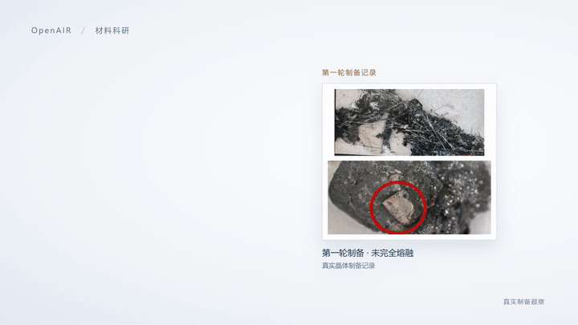

<p align="center">
  
</p>

<h3 align="center">A Trustworthy Closed-Loop Agent Platform for Scientific Discovery</h3>
<p align="center">
  Modeling the research process — <b>problem modeling → solution design → execution & validation → insight generation</b> — as an <b>orchestrable, verifiable, and traceable</b> closed loop; materials discovery as the first validated scenario
</p>
<p align="center">
  面向科学发现的可信闭环智能体平台 · 材料发现为首个验证场景
</p>

<p align="center">
  <a href="https://github.com/pdl-openair/OpenAIR/releases"></a>
  <a href="https://github.com/pdl-openair/OpenAIR/actions/workflows/oss-ci.yml"></a>
  <a href="LICENSE"></a>
  <a href="https://github.com/pdl-openair/OpenAIR/releases/download/v1.0.0/openair-demo.mp4">Demo Video</a> ·
  <a href="CONTRIBUTING.md">Contributing</a>
</p>

<p align="center"><a href="README.md">简体中文</a> | <b>English</b></p>

<p align="center">
  <a href="#-quick-start">Quick Start</a> ·
  <a href="#-features">Features</a> ·
  <a href="#-architecture">Architecture</a> ·
  <a href="#-validated-scenarios">Validated Scenarios</a> ·
  <a href="#-deployment-guide">Deployment</a> ·
  <a href="#️-roadmap">Roadmap</a> ·
  <a href="#-contributing">Contributing</a>
</p>

---

## 🗞️ News

- **2026-10-31**　🏁 **v1.0.0 — version calibration**: the platform has already been used in production research campaigns (crystal-discovery search mSUN 58.0%; AlN PVD d33 15.9 → 18.6 over four wet-lab feedback rounds), so per SemVer's "production use → 1.0.0" guidance the version is calibrated from v0.1.0 to v1.0.0. Also ships: openair-cli source in-repo, demo video & live workbench snapshot. [Release Notes](https://github.com/pdl-openair/OpenAIR/releases/tag/v1.0.0)
- **2026-10-31**　🧰 [openair-cli 0.2.0](https://pypi.org/project/openair-cli/): live Docker build progress, interactive env-config wizard (`openair config`), environment checkup (`openair doctor`), log tailing (`openair logs`)
- **2026-10-29**　🚀 v0.1.0 — first public release: four-stage orchestration runtime, 200+ research skills, evaluation & replay assets, dual execution mode (live / replay). [Release Notes](https://github.com/pdl-openair/OpenAIR/releases/tag/v0.1.0)

> Full version history: [Releases](https://github.com/pdl-openair/OpenAIR/releases).

## 📖 Overview

Research suffers from **long cycles, fragmented tooling, untraceable evidence, and underused experimental feedback**. OpenAIR models the research process as a four-stage lifecycle orchestrated by the platform: AI provides capabilities as *skills* at every stage, while researchers confirm plans, track progress, and verify evidence from a unified workbench. The platform is domain-agnostic — materials discovery and fabrication are the first fully validated scenarios; more domains arrive as skill packs.

**Highlights**

- 🔁 **Four-stage process model** — problem_modeling → solution_design → execution_validation → insight_generation. An organizational frame, not a rigid pipeline: new computational results or experimental feedback can re-enter earlier stages for supplementary analysis
- 🧩 **200+ Markdown-shaped skills** — SKILL.md + input/output schema contracts, unified registry, independently testable and replayable
- 🔍 **Traceable evidence** — every artifact's provenance chain (which skill, which inputs, which version) can be inspected end-to-end
- 🔬 **Dry/wet-lab synergy** — computational validation and experimental feedback iterate in one closed loop
- 🎭 **Dual execution mode** — `SKILL_EXEC_MODE=live` calls a real model gateway; `replay` replays fixtures so you can **walk the full pipeline with zero API keys**

## ✨ Features

| Capability | Description |
|---|---|
| Natural-language workbench | Start from a one-line research intent; confirm plans, track stage progress, browse artifacts |
| Skill registry & scheduling | Declarative registry + skill-bindings; skills auto-orchestrated per substage |
| Artifacts & evidence chain | Artifacts are first-class citizens with fully traceable provenance |
| Evaluation system | Effect evals (`evals/`), contract suites (`verification/suites/`), replay fixtures (`fixtures/`) |
| Platform integration | HPC (JCC), cloud lab platform, materials MCP, literature retrieval — all via environment variables, vendor-neutral |
| Multi-user & quotas | JWT login, bootstrap admin, user quotas (trial / free / pro / internal) |

## 🏗️ Architecture

```text
┌─────────────┐   ┌────────────────────────────────────────────┐
│  apps/web   │   │  services/api (FastAPI orchestration)       │
│  React workbench │──▶│ four-stage orchestration · artifacts · skills │
└─────────────┘   └──────────────┬─────────────────────────────┘
                                 │ SKILL_EXEC_MODE = live │ replay
                  ┌──────────────▼──────────┐   ┌──────────────────┐
                  │ skills/ + schemas/       │   │ services/worker   │
                  │ 200+ skills · registry   │   │ packages/llm_core │
                  └─────────────────────────┘   └──────────────────┘
```

- **Workbench** (`apps/web`): React 18 + Ant Design — task board / detail / artifact library / resource plaza
- **Orchestration runtime** (`services/api`): FastAPI, four-stage lifecycle, PostgreSQL persistence, durable-worker dispatch
- **Skill layer** (`skills/` + `schemas/`): 12 domain packs (materials / opentrajectory / pvd / cs_research …), `_template` starter kit
- **Contract & adapter layer** (`packages/`): `@openair/shared` type contracts / vendor-neutral `llm_core` transport / MCP · skill adapters

## 🔬 Validated Scenarios

| Scenario | Pipeline | Result |
|---|---|---|
| **Crystalline material discovery** | candidate generation → evolutionary search → computational validation (VASP band gap / stability) | search final evaluation **mSUN 58.0%** |
| **AlN thin-film PVD parameter optimization** | literature evidence → parameter recommendation → wet-lab fabrication → feedback iteration | four feedback rounds, d33 improved from 15.9 to **18.6** |

**👀 Live demo (no deploy, no login)**: [Mg-O wide-gap semiconductor screening · full four-stage workbench snapshot](https://pdl-openair.github.io/workbench/task_25047b1d994e4b6aa91578d595d75425) — the real frontend with request-level replay; browse stage progress, all artifacts and the evidence chain (read-only).



🎬 Full 45-second narrated demo: [watch inline on GitHub](https://github.com/pdl-openair/OpenAIR/blob/main/assets/openair-demo.mp4) · [download mp4](https://github.com/pdl-openair/OpenAIR/releases/download/v1.0.0/openair-demo.mp4) · [play on the project site](https://pdl-openair.github.io/OpenAIR/#demo)

<details>
<summary><b>External accounts needed to reproduce these scenarios</b></summary>

| Capability | Environment variables | Notes |
|---|---|---|
| Model gateway (skill execution + planning) | `ANTHROPIC_*` / `LLM_PROVIDER_*` | any Anthropic / OpenAI-compatible gateway |
| Materials Project | `MP_API_KEY` | **free**: https://next-gen.materialsproject.org/api |
| Materials MCP service | `MATERIALS_MCP_BASE_URL` | self-hosted or an existing MCP endpoint |
| HPC DFT (VASP) | `JCC_*` | when you have an HPC account |
| Cloud lab platform | `FLUX_BASE_URL` / `FLUX_API_KEY` | requires institutional VPN and a platform account |

Without these accounts: the platform itself (login, tasks, board, artifact library) and replay mode remain fully usable; nodes requiring external data/compute report an honest `partial_failure`.

</details>

---

## 🚀 Quick Start

Three paths, by increasing effort:

| Path | What you need | What you get |
|---|---|---|
| **A. Live demo** | a browser only | [full four-stage workbench snapshot](https://pdl-openair.github.io/workbench/task_25047b1d994e4b6aa91578d595d75425) (no login, read-only) |
| **B. Local, zero keys** | Docker + ~10 minutes | self-hosted platform + replay demo (see [zero-key replay demo](#zero-key-replay-demo-recommended-first-step)) |
| **C. Full capability** | B + model gateway / external accounts | live-mode research pipelines (accounts table under [Validated Scenarios](#-validated-scenarios)) |

### Prerequisites

- Docker 24+ (Docker Desktop or Engine with compose v2); for a manual setup see the [Deployment Guide](#-deployment-guide)

<details>
<summary><b>Option 1: one command via the openair CLI (recommended)</b></summary>

```bash
pipx install openair-cli        # or: pip install --user openair-cli
openair up                      # checkup → clone → generate .env → env-config wizard → start the stack → open the browser
openair up --mode replay        # zero-key replay demo — recommended first run
```

The first run walks you through environment config (execution mode replay/live; for live, the `ANTHROPIC_*` skill gateway and `LLM_PROVIDER_*` planner, keys hidden on input) and prints the login credentials **exactly once** (also written to `.env`); Docker build progress is streamed live. For local development: `uv tool install --force ./cli`. More: `openair config / status / logs / doctor / seed / down` (see [cli/README.md](cli/README.md)).

</details>

### Option 2: manual, three steps

### 1. Clone & configure

```bash
git clone https://github.com/pdl-openair/OpenAIR.git
cd OpenAIR
cp .env.example .env
```

The **4 variables compose hard-requires** in `.env` (the template ships local defaults, so it boots out of the box):

> [!NOTE]
> All comments in `.env.example` are on their own lines — copy the whole file safely. Inline comments (`KEY= # note`) get folded into the value by some Compose versions; this repo avoids that pitfall at the template level.

| Variable | Purpose |
|---|---|
| `POSTGRES_PASSWORD` | database password (must match between API and worker) |
| `OPENAIR_MINIO_ROOT_PASSWORD` | MinIO password |
| `OPENAIR_JWT_SECRET_KEY` | login JWT signing key |
| `OPENAIR_WORKER_AUTH_TOKEN` | API ↔ worker mutual auth token |

> [!IMPORTANT]
> For any externally reachable deployment, replace all four with random values (`openssl rand -hex 32`).

**Login account** (compose enforces authentication — this is required):

```bash
OPENAIR_BOOTSTRAP_ADMIN_EMAIL=you@example.com    # admin email
OPENAIR_BOOTSTRAP_ADMIN_PASSWORD=your-password   # at least 8 chars
OPENAIR_BOOTSTRAP_ADMIN_USERNAME=ops             # defaults to ops
```

### 2. Start

```bash
docker compose up -d --build     # first build takes a few minutes; re-run docker compose up -d after .env edits
```

> Slow/failing image pulls on mainland-China networks? See [Deployment Guide · Network configuration](#-deployment-guide).

### 3. Verify

| Service | URL |
|---|---|
| Workbench (Web) | http://localhost:8080 |
| API health | http://localhost:8000/health |
| MinIO console | http://localhost:9001 |

Log in to the workbench with the bootstrap admin account and start your first task.

#### Zero-key replay demo (recommended first step)

Set `SKILL_EXEC_MODE=replay` in `.env` and restart (`docker compose up -d`): startup no longer validates the model gateway, and skill execution replays in-repo fixtures — **no API keys needed**.

```bash
# in .env:
SKILL_EXEC_MODE=replay
```

Current boundaries (stated honestly):

- The **materials full workflow** is deterministic (no LLM planner involved) and can be started directly; external-data nodes such as "MP candidate search" report an honest `partial_failure` without `MP_API_KEY` (free — see the accounts table above)
- **Generic research tasks** are driven by the planner (`LLM_PROVIDER_*`), which replay mode does not yet cover — a real gateway key is required there
- `OPENAIR_DEV_SEED_FIXTURES=1` demo seeding currently works only with the `json` storage backend (not the compose default postgres); to see a fully populated workbench, use the **online snapshot demo** above

## 📦 Deployment Guide

<details>
<summary><b>Network configuration (mainland China)</b></summary>

If image pulls are slow or fail, configure Docker registry mirrors:

- **Docker Desktop**: Settings → Docker Engine, edit the JSON, then Apply & Restart
- **Linux**: edit `/etc/docker/daemon.json`, then `sudo systemctl restart docker`

```json
{
  "builder": { "gc": { "defaultKeepStorage": "20GB", "enabled": true } },
  "registry-mirrors": [
    "https://docker.1panel.live",
    "https://hub.rat.dev",
    "https://docker.mirrors.ustc.edu.cn",
    "https://hub-mirror.c.163.com",
    "https://mirror.baidubce.com"
  ]
}
```

> Mirror availability changes over time — replace with currently working mirrors if all fail.

For the manual (no-Docker) path, you can also switch package indexes:

```bash
pnpm config set registry https://registry.npmmirror.com
export UV_DEFAULT_INDEX=https://pypi.tuna.tsinghua.edu.cn/simple
```

</details>

<details>
<summary><b>Configuration groups</b> (full per-variable notes in <code>.env.example</code>)</summary>

| Group | Key variables | When needed |
|---|---|---|
| Execution mode | `SKILL_EXEC_MODE=live \| replay` | default `live`; `replay` for a zero-key walkthrough |
| Demo data | `OPENAIR_DEV_SEED_FIXTURES=1` | great for first-time users; keep 0 for daily use |
| Skill/Agent gateway | `ANTHROPIC_BASE_URL`, `ANTHROPIC_API_KEY`, `OPENAIR_CLAUDE_MODEL` | required for `live`; any Anthropic-compatible gateway |
| Planner (proposal/solution) | `LLM_PROVIDER_BASE_URL`, `LLM_PROVIDER_API_KEY`, `LLM_PROVIDER_MODEL` | required for `live`; OpenAI-compatible endpoint (avoid `…/api/anthropic` paths — they 404) |
| Literature retrieval | `OT_DEEPXIV_TOKEN`, `SEMANTIC_SCHOLAR_API_KEY` | only for literature skills |
| Materials MCP | `MATERIALS_MCP_BASE_URL`, `MP_API_KEY` | for live crystal-design pipelines |
| HPC (JCC) | `JCC_BASE_URL / JCC_USERNAME / JCC_PASSWORD / JCC_CLUSTER_NAME / JCC_CLI_PATH` | only when connecting HPC; the `jcc` CLI is not distributed in this repo — install it yourself and point `JCC_CLI_PATH` at it |
| Cloud lab platform | `FLUX_BASE_URL`, `FLUX_API_KEY` | requires institutional VPN and a platform account; without it, the resource plaza falls back to a local demo snapshot |

</details>

<details>
<summary><b>Services & ports</b></summary>

| Service | Port | Notes |
|---|---|---|
| web | 8080 (override via `OPENAIR_WEB_PORT`) | nginx same-origin reverse proxy to api |
| api | 8000 | FastAPI |
| postgres | 15432 (host) | database |
| minio | 9000 / 9001 | S3 / console |
| redis | 16379 | queue |

</details>

<details>
<summary><b>Manual deployment (no Docker)</b></summary>

Frontend (Node 20+ / pnpm 9):

```bash
pnpm install
pnpm --filter @openair/web dev
```

Backend (Python 3.12+, dependencies managed with [uv](https://docs.astral.sh/uv/); keep `.env` at the repo root):

```bash
cd services/api
uv sync
uv run uvicorn app.main:app --reload --host 0.0.0.0 --port 8000
# → http://localhost:8000/health returns {"status":"ok"}
```

Windows note: if `uv sync` fails with an SSL error, rebuild the venv with a signed Python (`uv venv --python <path-to-python.exe>`). See the [local development doc](docs/03_工程/待专项更新/LOCAL_DEVELOPMENT.md).

</details>

## 🗺️ Roadmap

| Version | Scope |
|---|---|
| **v1.1** | polish materials-domain skills; public benchmark table with one-command reproduction; python lint ratchet & backend tests in public CI |
| **v1.2** | domestic-accelerator validation (MXMACA / Ascend); continued `openair` CLI iteration (config wizard / doctor / logs / live progress shipped with [openair-cli 0.2.0](https://pypi.org/project/openair-cli/), see [cli/](cli/)) |
| **v1.x+** | more domains onboarded as skill packs (the platform is domain-agnostic); advanced production-deployment & ops guide |

## 🤝 Contributing

Issues and PRs are welcome! See [CONTRIBUTING.md](CONTRIBUTING.md) for the dev environment, commit conventions, and PR requirements.

- Never commit real secrets, intranet addresses, or personal data (CI runs a full gitleaks scan)
- New or modified skills must update `skills/registry.yaml` and the matching schemas, and stay replayable

## 📄 License

Released under the [Apache-2.0](LICENSE) license. Third-party components (e.g., externally sourced skills) follow their own notices.
