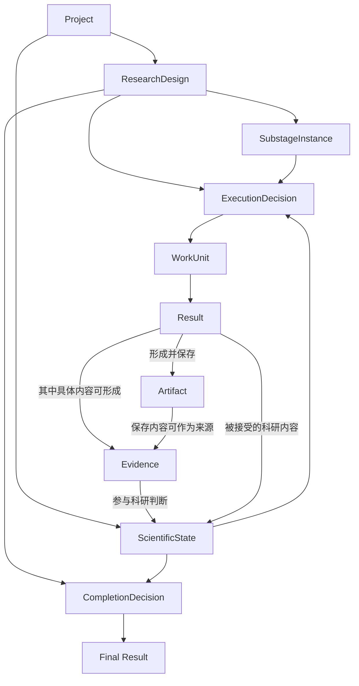

# OpenAIR 核心对象与数据模型

> 状态：已确认  
> 更新时间：2026-09-20  
> 职责：规定研究项目中的核心正式对象分别保存什么，以及这些对象之间的主要关系。

---

## 1. 核心对象地图

一个 OpenAIR 研究项目由四组核心对象共同描述：

| 类别 | 核心对象 | 回答的问题 |
| --- | --- | --- |
| **项目与方案** | Project、ResearchDesign、SubstageInstance | 这是什么研究、已经确认要研究什么、项目中有哪些研究任务 |
| **科研认识与依据** | Evidence、ScientificState | 研究依据是什么、当前项目已经接受了哪些科研认识 |
| **研究执行** | ExecutionDecision、WorkUnit、Result、Artifact | 下一步做什么、这一次怎样执行、实际产生和保存了什么 |
| **项目结束** | CompletionDecision、Final Result | 为什么现在可以结束、最终向用户交付什么 |

这些分组只帮助理解对象职责，不表示技术分层、存储层级或对象包含关系。

**Workflow** 是跨项目复用的研究工作结构，不属于单个研究项目内部的核心对象。项目使用 Workflow 形成 ResearchDesign 时，ResearchDesign 应能够追溯实际使用的 Workflow 版本或稳定引用。

---

## 2. 主要对象关系



图中的连线表示主要领域关系，不表示对象包含关系、完整数据依赖或物理存储方式。

Evidence 始终保留为独立正式对象；ScientificState 保存当前项目已经接受的科研认识及其证据关系，不替代 Evidence。

---

## 3. 核心对象定义

| 对象 | 保存什么 |
| --- | --- |
| **研究项目（Project）** | 一项完整研究的身份，以及该项目核心对象之间的关联关系。 |
| **研究方案（ResearchDesign）** | 当前已经确认的研究目标、问题结构、范围与约束、项目研究任务及依赖、研究工作要求、项目完成要求，以及预算、外部动作和风险边界。 |
| **项目研究任务（SubstageInstance）** | 某类研究工作进入当前项目后形成的具体任务身份。 |
| **证据（Evidence）** | 能够支持、反驳或限制某个科研判断的具体依据，以及其来源、适用条件和不确定性。 |
| **科研状态（ScientificState）** | 当前项目已经接受的结论、假说、冲突、研究缺口、不确定性、证据关系，以及研究目标的当前完成情况。 |
| **执行决定（ExecutionDecision）** | 根据当前 ResearchDesign、相关 SubstageInstance 和最新 ScientificState 形成的下一步研究决定。 |
| **执行工单（WorkUnit）** | 一次具体执行的正式输入快照，冻结对应研究工作、执行方法版本（如有）、本次执行能力、正式输入及来源引用、工作要求和执行边界。 |
| **执行结果（Result）** | 一次具体执行实际产生的内容。 |
| **研究产物（Artifact）** | 研究过程中已经保存、可供查看、追溯或继续使用的具体产物。 |
| **完成判断（CompletionDecision）** | 项目已经满足结束条件时形成的正式判断及其依据。 |
| **最终结果（Final Result）** | 整个研究项目最终交付给用户的正式结果。 |

---

## 4. 必须区分的对象关系

### 4.1 ResearchDesign 与 ScientificState

两者保存不同类型的当前事实：

| 对象 | 保存的当前事实 |
| --- | --- |
| **ResearchDesign** | 项目已经确认要研究什么、需要完成什么、遵守什么要求和边界 |
| **ScientificState** | 研究推进到当前时点，项目已经接受了什么科研认识，还存在哪些缺口和不确定性 |

新的证据、纠错或科研判断改变当前科研认识时，更新 ScientificState。

需要改变已经确认的研究目标、任务、要求或边界时，形成新的 ResearchDesign，而不是通过修改 ScientificState 改变研究方案。

实现可以保存 ScientificState 的旧版本、快照或变更记录用于追溯，但当前项目在同一时点只有一个当前有效 ScientificState。

### 4.2 SubstageInstance、ExecutionDecision 与 WorkUnit

三个对象分别表示**研究任务身份、下一步研究决定和一次具体执行快照**。

```text
SubstageInstance
+ 当前 ResearchDesign
+ 最新 ScientificState
→ ExecutionDecision
→ WorkUnit
```

同一个 SubstageInstance 可以根据研究推进需要被执行多次，因此可以对应多次 ExecutionDecision 和多张 WorkUnit。

WorkUnit 保存本次执行已经冻结的正式内容，但不替代这些输入各自原有的 Authority。

### 4.3 Result、Artifact、Evidence 与 ScientificState

这四个对象分别保存不同事实：

| 对象 | 表示什么 |
| --- | --- |
| **Result** | 一次执行实际产生了什么 |
| **Artifact** | 什么具体内容已经被保存下来 |
| **Evidence** | 什么具体依据能够支持、反驳或限制科研判断 |
| **ScientificState** | 当前项目已经接受了什么科研认识 |

Result 中的内容可以被保存为 Artifact；Result、Artifact 或其他正式来源中的具体内容，当它被确定为能够支持、反驳或限制某个科研判断时，形成 Evidence。

Evidence 至少保留其来源、支持或限制的科研判断、适用条件和不确定性。

Artifact 与 Evidence 在逻辑上是不同对象，但不要求因此采用不同的物理存储方式。

### 4.4 CompletionDecision 与 Final Result

**CompletionDecision**保存“项目为什么已经可以结束，以及判断依据是什么”。

**Final Result**保存项目最终向用户交付的正式结果。

CompletionDecision 使用当前 ResearchDesign 的项目完成要求和最新 ScientificState 形成；项目确认可以结束后，再进入 Final Result 的生成与交付。

#### 4.4.1 Workflow 目标归属、适用性与复用接受

Workflow 已声明的目标由 frozen `targetOutputSpecs.ownerNodeKey` 所对应职责拥有；Query 新增目标通过明确的科研职责关联进入 ResearchDesign。最终综合工作可以引用上游成果，不因此拥有上游目标。一个职责拆为多个工作项时，这些工作项共同承担该职责目标；不能只把目标留给最后一个工作项。

项目完成要求保留所有目标，并以可选 `workflowResponsibilityKey` 绑定当前正式职责覆盖。目标描述改写或新增不能删除已冻结目标，也不能靠自然语言猜测其拥有者；无法明确关联时报告规划缺口。

Query 组合成果可用可选 `contributingResponsibilityKeys` 保存全部必要贡献职责。字段可选用于历史兼容，列表中的必要贡献不能省略核验。服务器从合法科研关联与正式职责覆盖确定性生成列表，不要求模型填写正式身份。冻结目标的单值 owner 不变；组合当前工作须覆盖全部必要实例及目标接受条件，复用贡献逐项核验当前设计版本、完整来源与实际接受，未选贡献仅沿既有条件性不适用规则。全部必要贡献满足后目标才满足；修订保留贡献列表，旧版本接受不能替代当前接受。

覆盖报告的 `executable_with_gaps` 表示至少有一项合法工作，执行结构和必要边界检查通过，但仍存在成果覆盖缺口。目标、`none/partial` 覆盖及未覆盖身份完整保留。该状态允许用户确认已有合法工作，不表示目标覆盖通过或研究完成；必要边界缺口、非法执行引用、依赖或超限仍不得借此确认。完成判断继续如实保留未满足目标。

条件性职责本轮不适用时，目标保留，完成核验显式记录 `fulfillmentStatus=not_applicable`；不因此强制新增任务。已有成果被规划采用时，目标保留为 `reuse_pending`。采用、推荐、存在一个旧 Artifact 均不构成当前项目接受事实。

只有当前项目执行实际核查所提供材料，形成明确的复用适用性判断，并按该执行已冻结的产物接受规则通过后，才记录 `reuse_accepted`。判断必须绑定当前 ResearchDesign ID/版本、目标引用、职责、完整复用来源集合与接受产物引用；历史版本、其他目标、其他来源和待审阅产物均不能替代。当前执行的接受产物仍须可用、可追溯。后续不相关判断不得抹掉已有接受证据。

通用研究产物的可选 `targetOutputReuseJudgments` 逐项保存上述目标/职责/来源、`verdict=accepted` 与非空判断依据；系统从正式 Result/WorkUnit 补全设计和产物身份。待审阅判断只保存在 Result，通过现有审阅后再进入 ScientificState。无审阅要求且产物已可用时，明确的接受判断记录为 `target_output_reuse_accepted`。这个事件只接受所声明目标的复用，不能授予该工作其他科研判断的专业验收。既有独立审阅的 `acceptance_recorded` 可以使用输入产物引用表达被接受成果。

CompletionDecision 仅消费当前 ResearchDesign 和最新 ScientificState 的上述事实，向用户说明目标的不适用、待接受复用或已接受复用状态及缺口。只完成末项建议不能让未完成的记录或证据目标变成已完成。历史没有新增字段的 ResearchDesign 保持原合同读取，不改写历史对象。


---

## 5. 工程记录与核心对象

系统可以为了运行、恢复、追溯和展示保存规划记录、执行记录、Provider 调用证据、资源使用记录、只读投影和缓存等工程数据。

这些数据分别服务于运行事实追溯、恢复或展示。它们可以长期保存，也可以拥有独立的数据结构，但不会因此自动成为新的项目核心对象或研究决策 Authority。

项目中的研究方案、科研状态、下一步研究决定和完成判断，仍分别由对应的正式核心对象表达。

面向页面或工作台的只读视图可以从正式对象和必要工程记录生成，但不能形成第二套 ResearchDesign、ScientificState 或其他正式研究状态。
