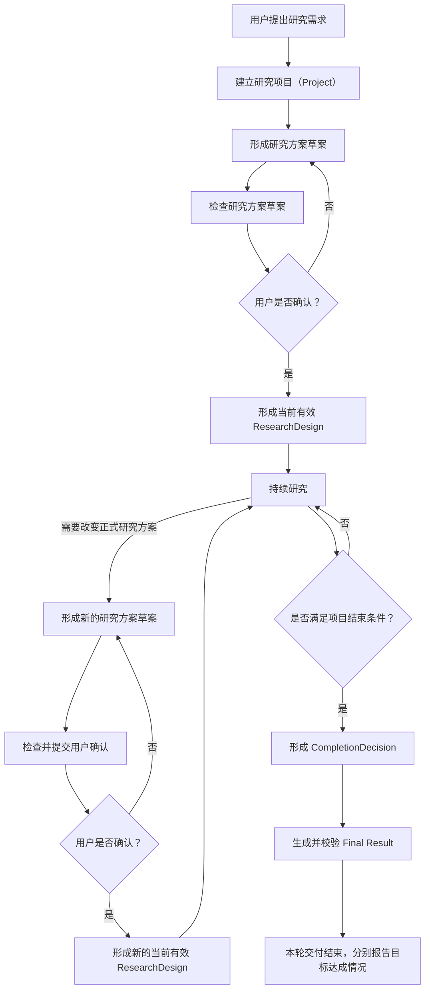

# OpenAIR 研究项目生命周期

> 状态：已确认  
> 更新时间：2026-10-10
> 职责：规定一个研究项目从提出需求到最终交付经历的正式阶段、阶段转换条件，以及需要用户参与的关键节点。

---

## 1. 生命周期概览

一个研究项目沿三段主线推进：

```text
建立项目并确认 ResearchDesign
→ 持续研究
→ 完成判断与最终交付
```

完整生命周期如下：



其中：

- **ResearchDesign**规定当前已经确认的研究目标、任务、要求和边界；
- **ScientificState**记录研究推进过程中当前已经接受的科研认识；
- **CompletionDecision**记录本轮结束依据及原目标是否达成；
- **Final Result**是项目最终交付给用户的正式结果。

---

## 2. 建立项目并确认 ResearchDesign

用户发起一项完整研究时，系统建立 **Project**，并形成研究方案草案。

研究方案草案至少需要让用户能够确认三个问题：

1. **这个项目要解决什么研究问题；**
2. **需要完成哪些研究工作；**
3. **满足什么条件时项目可以结束。**

草案还必须包含本次研究需要确认的正式范围、约束和执行边界。

草案在提交用户确认前先经过相应检查。检查通过后，由用户确认研究目标、项目研究任务、项目完成要求和需要确认的正式边界。

检查区分执行有效性与成果覆盖完整性：已有合法可执行工作、必要边界完整，仅成果安排存在缺口时，以 `executable_with_gaps` 保留目标和缺口，允许用户阅读并确认已有工作。不为缺口虚构关联或删掉目标，也不因此将研究标记完成。必要边界或执行结构不合法时仍需修正后确认。组合成果只有满足全部必要当前工作及复用接受，才能声称完整达成；无法达成时按§4诚实交付，不以部分内容冒充完整成果。

```text
研究方案草案
→ 检查
→ 用户确认
→ 当前有效 ResearchDesign
```

**研究方案草案 ≠ ResearchDesign。**

只有经过检查并由用户确认的方案，才能成为当前有效 ResearchDesign，并作为后续研究的正式方案依据。未确认的草案不能提前取得正式 ResearchDesign 的地位。

---

## 3. 持续研究与 ResearchDesign 变更

ResearchDesign 确认后，项目进入持续研究阶段。

研究在当前有效 ResearchDesign 和最新 ScientificState 的约束下持续推进。持续研究阶段内部怎样决定和执行下一步研究工作，由《OpenAIR 研究执行机制》规定。

只要研究仍处于当前 ResearchDesign 已经确认的目标、任务、要求和边界内，系统可以根据最新 ScientificState 调整具体执行安排。

如果研究推进需要改变以下任何正式方案内容，就必须形成新的研究方案草案：

- 研究目标；
- 研究范围或约束；
- 项目研究任务及其依赖；
- 研究工作要求；
- 项目完成要求；
- 已确认的预算、外部动作或风险边界。

新的草案同样需要经过检查和用户确认，才能成为新的当前有效 ResearchDesign。

```text
当前有效 ResearchDesign
→ 发现正式方案需要改变
→ 新的研究方案草案
→ 检查
→ 用户确认
→ 新的当前有效 ResearchDesign
```

未确认的新草案不能直接改写当前正式 ResearchDesign。

纠错、补证、读取代码和取得原职责所需输入，属于已确认边界内正常执行，不自动改变项目任务或正式依赖，也不默认要求用户确认。系统按既有顺序、依赖及注册能力推进；Agent 的理解与纠错不能变成重新规划研究。绑定方法的角色及控制关系保持；内部补证不增加角色。历史方案缺少合法补证路径时，必须明确能力或实现缺口并修复，不能以无历史重入授权无限等待，也不能暗改方法版本。

新规则适用于后续执行与交付，不回写历史方案、结果或原目标验收事实。需要新增外部权限、预算或改变科研含义时，仍须明确向用户提出具体变更。

---

## 4. 完成判断与最终交付

持续研究过程中，系统根据：

- 当前有效 ResearchDesign 中的项目完成要求；
- 最新 ScientificState；

判断项目是否已经满足结束条件。

尚未满足且存在可开展的合法工作时，项目继续研究。不能把科研内容必须成功作为持续研究的普遍门禁。

满足结束条件时，形成正式 **CompletionDecision**。原目标不可达、已确认预算耗尽或合法恢复已穷尽时，也须通过同一 CompletionDecision / Final Result 链交付当前有效成果及未完成原因；结束本轮运行不等于满足原目标。不得修改原目标、降低原验收条件或伪造执行来满足结束条件。系统未实现本可恢复的能力必须记为实现缺陷，不能借诚实交付计为恢复成功。CompletionDecision 需要如实保存项目能够结束的依据，以及仍然存在的未满足事项、证据缺口、限制或不确定性。

项目不要求消除所有不确定性后才能结束。只要当前 ResearchDesign 的项目完成要求允许结束，合理的不确定性和未解决问题可以保留在完成判断和最终结果中。

CompletionDecision 形成后，系统生成并校验 **Final Result**。

Final Result 校验并保存后，本轮研究交付结束；原目标是否达成依据原 ResearchDesign 单独判断并展示。Task 正式终态由既有唯一生命周期机制形成，不能凭最终正文存在推断科研成功。

```text
原项目完成要求与已确认边界
+ 最新 ScientificState / 合法恢复结算事实
→ CompletionDecision（分别记录结束依据与目标达成）
→ Final Result
→ 本轮交付结束
```

---

## 5. 用户参与

用户可以选择自动推进、阶段确认或逐步确认。推进方式决定系统在研究过程中何时暂停等待用户，但不改变 ResearchDesign、ScientificState、ExecutionDecision 或 CompletionDecision 各自的正式语义。

| 时间点 | 用户参与 |
| --- | --- |
| **提出研究需求** | 提供研究问题、已知条件和必要约束 |
| **研究方案草案形成后** | 确认研究目标、研究任务、项目完成要求和重要边界 |
| **持续研究过程中** | 补充研究继续所必需且系统无法自行获得的信息；需要改变正式方案时，确认新的 ResearchDesign |
| **项目完成后** | 查看 Final Result、主要依据、限制和未解决问题 |

内部运行故障本身不构成新的研究确认节点。只有确实缺少用户掌握的必要信息，或者研究变化已经触及 ResearchDesign 边界时，才因研究需要请求用户参与。
