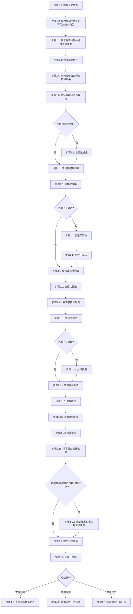
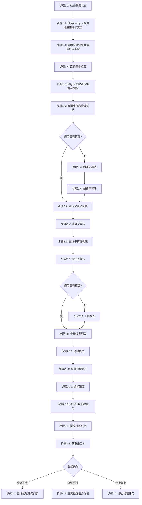

# 智算任务步骤

## 概述

本文件定义提交智算任务（大模型训练/推理）的执行步骤。

***

## 训练任务步骤

### 流程图



### 流程说明

- **阶段1-3**（准备工作、填写任务创建信息、提交任务）为**线性流程**，按顺序执行
- **阶段4**（查询列表、查询详情、查询日志、查询结果）为**非线性流程**，用户可根据需要独立调用，**除非用户明确提及，否则不自动触发**

### 阶段1：准备工作

#### 步骤1.1：检查登录状态

```bash
# 尝试执行一个轻量命令验证登录状态
jcc aitrain query --output text
```

如果命令因未授权/缺少 token 失败，则执行登录并设置环境变量：

```bash
$login = jcc login --username <username> --password <password> | ConvertFrom-Json
$env:JCC_TOKEN = $login.token
$env:JCC_USER_ID = $login.userID
$env:JCC_BASE_URL = "https://jcc.jointcloud.net"
```

#### 步骤1.2：查询可用加速卡类型

调用 `cardtype` 接口获取当前用户可用的所有加速卡类型及资源配额：

```bash
jcc aitrain cardtype --output text
```

**输出示例**:
```
=== 智算训练可用加速卡类型（共 7 种） ===
TYPE            GPU_NUM  CPU_MAX  MEMORY_MAX  STORAGE_MAX
METAX-GPGPU     1        20       64          1024
DCU             3        25       100         1024
GCU             2        16       32          1024
GPU             3        16       40          1024
ILUVATAR-GPGPU  3        60       128         1024
NPU             4        320      32          1024
MLU             1        16       128         1024
```

从返回结果中提取所有可用的加速卡类型（TYPE 列）。

#### 步骤1.3：展示查询结果并选择资源类型

将步骤1.2查询到的资源类型列表展示给用户，引导用户选择一个资源类型：

```bash
# 示例：查询结果返回 GPU、NPU、MLU 三种类型
# 展示给用户后，用户选择其中一种
$resourceType = "<用户选择的资源类型>"
```

**说明**：用户选择的资源类型将用于步骤1.5的 `--type` 参数过滤。

#### 步骤1.4：选择镜像标签

```bash
# 选择镜像标签，如 pytorch、tensorflow
$imageTags = "pytorch"
```

**镜像标签说明**:

- 镜像标签用于筛选支持特定框架的运行环境
- 可指定多个标签，使用逗号分隔，例如 `pytorch,tensorflow`

#### 步骤1.5：根据选定资源类型获取集群和资源规格列表

根据用户在步骤1.3选定的资源类型，带 `--type` 参数调用查询接口获取该类型下的集群和资源规格列表：

```bash
# 查询支持的集群列表
jcc aitrain cluster-list --type $resourceType --output text
```

**集群列表参数说明**:

- `--type`: 资源类型（必填），支持 METAX-GPGPU/MLU/NPU/ILUVATAR-GPGPU/GCU/GPU/DCU

**输出示例**:

```bash
ID              Name            Status    ResourceType
----            ----            ------    ------------
cluster-001     AI-GPU-Cluster  active    GPU
cluster-002     AI-MLU-Cluster  active    MLU
```

#### 步骤1.6：选择集群和资源规格

```bash
# 记录选中的集群名称
$selectedCluster = "AI-GPU-Cluster"

# 记录选中的资源规格ID（flavor-id）
$selectedFlavorId = "14447503"
```

**说明**: 集群通过 `--cluster-name` 指定；资源规格通过 `--resource` 参数指定，格式为 `TYPE:TYPE:NUMBER*NAME(显存:XXGiB),CPU:N,内存:NGiB:1`（可多次指定），如 `GPU:GPU:1*A100(显存:40GiB),CPU:8,内存:50GiB:1`。选中的flavor-id将用于后续镜像过滤。

### 阶段2：确认数据集、算法、模型和镜像

#### 步骤2.1：确认数据集使用方式

**询问用户**: 是否使用平台中已有的数据集？

- **是**: 进入步骤2.2查询数据集列表并选择
- **否**: 进入步骤2.3上传新数据集

#### 步骤2.2：查询数据集列表（使用已有数据集）

```bash
jcc dataset query --output text
```

**输出示例**:

```bash
=== dataset 列表 ===
PACKAGE ID  NAME                                       TYPE     CREATE TIME
20122       ds0714test                                 dataset  2026-07-14T14:59:38+08:00
20067       test071305                                 dataset  2026-07-13T16:15:12+08:00
18415       ddsdsdsd                                   dataset  2026-06-02T10:22:47+08:00
```

**列表展示不全处理**:

- 如果列表过长，使用分页查询：`jcc dataset query --page 2 --size 20 --output text`
- 如果所需数据集不在列表中，用户可以直接输入数据集名称进行选择（系统会验证名称是否存在）

#### 步骤2.3：上传新数据集（重新上传）

```bash
jcc dataset create \
  --name <dataset-name> \
  --path <local-data-path> \
  --cluster-name <cluster-name>
```

**参数说明**:

- `--name`: 数据集名称（必填）
- `--path`: 本地数据文件或目录路径（必填）
- `--cluster-name`: 目标集群名称（必填）

#### 步骤2.4：选择数据集

```bash
# 用户选择数据集名称或ID
$selectedDataset = "mnist-train"
```

**说明**: 如果列表中没有所需数据集，用户可以直接输入数据集名称，系统会验证名称是否存在。

**验证失败错误提示**:

```
dataset <名称> 不存在
```

#### 步骤2.5：确认算法使用方式

**询问用户**: 是否使用平台中已有的算法？

- **是**: 进入步骤2.6查询父算法列表
- **否**: 进入步骤2.7创建父算法，然后进入步骤2.8创建子算法

#### 步骤2.6：查询父算法列表（使用已有算法）

查询平台上已有的父算法包列表：

```bash
jcc algo query --output text
```

**输出示例**:

```bash
=== algo 列表 ===
PACKAGE ID  NAME                                                             TYPE  CREATE TIME
20390       zhouqjtest07172241                                               code  2026-07-17T22:41:55+08:00
20185       test0717002                                                      code  2026-07-17T20:15:41+08:00
20184       test0717001                                                      code  2026-07-17T20:15:12+08:00
16532       finetuning                                                       code  2026-03-26T11:24:25+08:00
```

**列表展示不全处理**:

- 如果列表过长，使用分页查询：`jcc algo query --page 2 --size 20 --output text`
- 如果所需父算法不在列表中，用户可以直接输入父算法名称进行选择（系统会验证名称是否存在）

#### 步骤2.7：创建父算法

当平台中没有所需父算法时，先创建父算法包：

```bash
jcc algo create \
  --name <parent-algo-name> \
  --path <local-code-path> \
  --clusters <cluster-name>
```

**参数说明**:

- `--name`: 父算法名称（必填）
- `--path`: 本地代码文件或目录路径（必填）
- `--clusters`: 目标集群名称，可多次指定（必填）

**说明**: 创建父算法后，必须继续创建子算法才能提交训练任务。

#### 步骤2.8：创建子算法

在已创建的父算法基础上，创建子算法：

```bash
jcc algo fork \
  --parent-name <parent-algo-name> \
  --cluster-name <cluster-name> \
  --description <child-algo-name>
```

**参数说明**:

- `--parent-name`: 父算法包名称（必填）
- `--cluster-name`: 目标集群名称（必填）
- `--description`: 子算法名称（必填）

**说明**:

- 子算法基于父算法创建，用于指定目标集群和运行配置
- 创建子算法后，算法名称格式为 `父算法名称/子算法名称`，如 `finetuning02/finetuning0201`

#### 步骤2.9：选择父算法

从步骤2.6查询到的父算法列表中，选择目标父算法：

```bash
# 用户选择父算法名称
$selectedParentAlgo = "finetuning02"
```

**说明**:

- 父算法是代码包的根节点，包含基础代码文件
- 如果列表中没有所需父算法，用户可以直接输入父算法名称，系统会验证名称是否存在

#### 步骤2.10：查询子算法列表

根据已选择的父算法，查询该父算法下可用的子算法列表：

```bash
jcc algo query --package-name <parent-algo-name> --output text
```

**输出示例**:

```bash
=== algo 详情 ===
PACKAGE ID  NAME              TYPE  CREATE TIME
16533       finetuning0201    code  2026-03-26T11:30:00+08:00
16534       finetuning0202    code  2026-03-26T12:00:00+08:00
```

**说明**:

- 必须指定 `--package-name` 为已选择的父算法名称
- 子算法列表展示了基于该父算法在不同集群或配置下创建的子算法
- 如果父算法下没有子算法，需要先执行步骤2.8创建子算法

#### 步骤2.11：选择子算法

从子算法列表中选择目标子算法，并组合成任务提交所需的算法名称格式：

```bash
# 用户选择子算法名称
$selectedChildAlgo = "finetuning0201"

# 组合为任务提交格式：父算法名称/子算法名称
$selectedAlgo = "$selectedParentAlgo/$selectedChildAlgo"
# 示例：finetuning02/finetuning0201
```

**说明**:

- **算法名称格式要求**: 必须为 `父算法名称/子算法名称` 格式
- 如果子算法列表中没有所需子算法，用户可以直接输入子算法名称，系统会验证名称是否存在
- 提交训练任务时，`--code-name` 参数必须使用该格式

**验证失败错误提示**:

```
code <名称> 不存在
```

#### 步骤2.12：确认模型使用方式

**询问用户**: 是否使用平台中已有的模型？

- **是**: 进入步骤2.13查询模型列表并选择
- **否**: 进入步骤2.14上传新模型
- **不使用**: 跳过模型选择，进入步骤2.15

#### 步骤2.13：查询模型列表（使用已有模型）

```bash
jcc model query --output text
```

**输出示例**:

```bash
=== model 列表 ===
PACKAGE ID  NAME                                           TYPE   CREATE TIME
20070       my-model                                       model  2026-07-13T16:20:30+08:00
18625       vaspmodel881                                   model  2026-06-08T17:13:07+08:00
18219       model20260519                                  model  2026-05-19T16:33:45+08:00
```

**列表展示不全处理**:

- 如果列表过长，使用分页查询：`jcc model query --page 2 --size 20 --output text`
- 如果所需模型不在列表中，用户可以直接输入模型名称进行选择（系统会验证名称是否存在）

#### 步骤2.14：上传新模型（重新上传）

```bash
jcc model create \
  --name <model-name> \
  --path <local-model-path> \
  --cluster-name <cluster-name>
```

**参数说明**:

- `--name`: 模型名称（必填）
- `--path`: 本地模型文件或目录路径（必填）
- `--cluster-name`: 目标集群名称（必填）

#### 步骤2.15：选择模型

```bash
# 用户选择模型名称或ID，或不使用模型
$selectedModel = "resnet50"  # 或 $selectedModel = "" 表示不使用
```

**说明**: 如果列表中没有所需模型，用户可以直接输入模型名称，系统会验证名称是否存在。训练任务中模型为可选参数。

**验证失败错误提示**:

```
model <名称> 不存在
```

#### 步骤2.16：查询镜像列表

使用 `jcc image list` 命令查询平台可用镜像，**必须使用步骤1.6中选中的flavor-id进行过滤**，确保只返回与所选资源规格匹配的镜像：

```bash
# 使用选中的资源规格ID过滤镜像列表
jcc image list --flavor-id $selectedFlavorId --output text
```

**输出示例**:

```bash
total: 1  page: 1  size: 10

=== 镜像列表 ===
ID   External ID                       Name         Tag          Kind  Provider      Status     Description                                            Created
388  13646ee29cd19cb89bf6966f8e4ce004  enflame-t20  enflame-t20  ai    中国算力网-启智社区集群  available  燧原GCU的调试任务推荐镜像，只适配t20...  2026-02-06 02:22:22
```

**列表展示不全处理**:

- 如果列表过长，使用分页查询：`jcc image list --flavor-id $selectedFlavorId --page 2 --size 20 --output text`
- 如果所需镜像不在列表中，用户可以直接输入镜像名称进行选择（系统会验证名称是否存在）

**说明**: 通过flavor-id过滤后，只返回与所选资源规格兼容的镜像，避免出现全量镜像选择。

**常用查询方式**:

```bash
# 使用选中的资源规格过滤
jcc image list --flavor-id $selectedFlavorId --output text

# 结合标签进一步过滤
jcc image list --flavor-id $selectedFlavorId --tag pytorch --output text

# 结合名称进一步过滤
jcc image list --flavor-id $selectedFlavorId --name cann --output text

# 分页查询
jcc image list --flavor-id $selectedFlavorId --page 1 --size 20 --output text

# 输出JSON格式
jcc image list --flavor-id $selectedFlavorId --output json
```

**参数说明**:

| 参数            | 说明                        | 默认值 |
| ------------- | ------------------------- | --- |
| `--flavor-id` | 按资源规格ID过滤（**必填**，来自步骤1.6） | -   |
| `--tag`       | 按镜像标签模糊查询（可选）             | -   |
| `--name`      | 按镜像名称模糊查询（可选）             | -   |
| `--page`      | 分页页码                      | 1   |
| `--size`      | 每页数量                      | 10  |

#### 步骤2.17：选择镜像

```bash
# 用户选择镜像名称或ID
$selectedImage = "enflame-t20"
```

> **注意**:
>
> - 提交任务时，`--image-id` 和 `--image-name` 二选一即可
> - **镜像上传说明**: 当前 jcc CLI 不支持通过命令行上传镜像，用户只能选择平台上已有的镜像
> - **验证失败错误提示**:
>   ```
>   镜像 <名称> 不存在（返回 0 条: []）
>   ```

#### 步骤2.18：填写任务创建信息

根据已选资源规格、数据集、算法、模型和镜像填写任务创建信息：

**填写内容包含**:

- 数据集名称（`--dataset-name`，必须使用 name 类参数，ID 类参数虽返回成功但任务不会入表）
- 代码/算法名称（`--code-name`，必须使用 name 类参数，ID 类参数虽返回成功但任务不会入表）
- 模型名称（`--model-name`，必须使用 name 类参数，ID 类参数虽返回成功但任务不会入表）
- 镜像名称（`--image-name`，必须使用 name 类参数，ID 类参数虽返回成功但任务不会入表）
- 已选资源规格（`--resource`）

#### 步骤2.19：检查数据集/模型集群一致性并调度

在提交训练任务前，检查已选数据集和模型所在的集群是否与训练任务的目标集群（步骤1.6选定的集群）一致。如果不一致，需要先将数据集和模型调度到目标集群。

**检查逻辑**:

1. 从步骤2.2/2.3数据集查询结果中，获取数据集所在的集群（cluster）
2. 从步骤2.13/2.14模型查询结果中，获取模型所在的集群（cluster）
3. 将数据集集群、模型集群与步骤1.6选定的训练目标集群进行对比

**如果一致**：直接进入步骤3.1提交训练任务

**如果不一致**：执行以下调度命令

**调度数据集到目标集群**:

```bash
jcc dataset schedule --cluster-name <目标集群名称> --package-name <数据集名称>
```

**调度模型到目标集群**（如果使用了模型）:

```bash
jcc model schedule --cluster-name <目标集群名称> --package-name <模型名称>
```

**参数说明**:

- `--cluster-name`: 目标集群名称（必填），即步骤1.6选定的训练集群名称
- `--package-name`: 数据集/模型名称（必填），从查询结果中获取

> **注意**: 调度是异步操作，提交调度命令后需等待数据同步完成。可通过查询数据集/模型状态确认是否已同步（状态为 `synced` 或 `ready` 表示已就绪）。调度完成后才能提交训练任务。

### 阶段3：提交训练任务

#### 步骤3.1：构建提交命令

```bash
jcc aitrain submit \
  --name <task-name> \
  --cluster-name <cluster-name> \
  --code-name <code-name> \
  --dataset-name <dataset-name> \
  --model-name <model-name> \
  --image-name <image-name> \
  --resource <resource-spec> \
  [--command <run-command>] \
  [--description <description>] \
  [--env <key=value>] \
  [--param <key=value>] \
  [--schedule-strategy <strategy>] \
  [--data-file <json-file>]
```

**参数详细说明**:

- `--name`: 任务名称（必填），用于标识训练任务
- `--cluster-id` / `--cluster-name`: 目标集群。必须使用 name 类参数（--cluster-name、--code-name 等），ID 类参数虽返回成功但任务不会入表
- `--code-binding-id` / `--code-name`: 代码/算法。必须使用 name 类参数（--cluster-name、--code-name 等），ID 类参数虽返回成功但任务不会入表
- `--dataset-binding-id` / `--dataset-name`: 数据集。必须使用 name 类参数（--cluster-name、--code-name 等），ID 类参数虽返回成功但任务不会入表
- `--model-binding-id` / `--model-name`: 模型。必须使用 name 类参数（--cluster-name、--code-name 等），ID 类参数虽返回成功但任务不会入表
- `--image-id` / `--image-name`: 镜像。必须使用 name 类参数（--cluster-name、--code-name 等），ID 类参数虽返回成功但任务不会入表
- `--resource`: 资源规格（必填），格式为 `TYPE:TYPE:NUMBER*NAME(显存:XXGiB),CPU:N,内存:NGiB:1`（可多次指定），如 `GPU:GPU:1*A100(显存:40GiB),CPU:8,内存:50GiB:1`
- `--command`: 运行命令（可选），自定义启动命令
- `--description`: 任务描述（可选）
- `--env`: 环境变量（可选，可多次），如 `--env CUDA_VISIBLE_DEVICES=0,1,2,3`
- `--param`: 运行参数（可选，可多次），如 `--param epochs=3`
- `--schedule-strategy`: 调度策略（可选），默认 `dataLocality`
- `--data`: 完整 jobSet JSON（可选，优先级低于 --data-file）
- `--data-file`: 完整 jobSet JSON 文件（可选）
- `--local-job-id`: 本地任务ID（可选，默认 1）

**示例**:

```bash
jcc aitrain submit \
  --name llama2-finetune \
  --cluster-name AI-GPU-Cluster \
  --code-name cifar10/openi_gcu_cifar10 \
  --dataset-name my-dataset \
  --model-name llama2-7b \
  --image-name pytorch:2.0 \
  --resource GPU:GPU:1*A100(显存:40GiB),CPU:8,内存:50GiB:1 \
  --command "python train.py --epochs 3 --batch_size 32" \
  --description "Llama2 7B fine-tuning" \
  --env CUDA_VISIBLE_DEVICES=0 \
  --param learning_rate=1e-5 \
  --schedule-strategy dataLocality
```

> 注意：name 类参数在 --dry-run 模式下验证会失败（报"submit 需要 --cluster-id 或 --cluster-name"），但实际提交（不带 --dry-run）正常工作

#### 步骤3.2：获取任务ID

提交成功后返回任务信息：

```bash
{
  "taskId": "train-1234567890",
  "name": "llama2-finetune",
  "status": "pending",
  "submitTime": "2024-01-15T10:30:00Z"
}
```

### 阶段4：监控训练任务

#### 步骤4.1：查询训练任务列表

```bash
jcc aitrain query --output text
```

**输出示例**:

```bash
ID              Name              Status    SubmitTime
-----           ----              ------    ----------
train-123456    llama2-finetune   running   2024-01-15T10:30:00Z
train-789012    bert-training     completed 2024-01-14T09:00:00Z
```

#### 步骤4.2：查询训练任务详情

```bash
jcc aitrain detail --task-id <task-id>
```

**参数说明**:

- `--task-id`: 任务ID（优先使用）

**详情内容**:

- 任务基本信息（名称、状态、提交时间）
- 资源配置（GPU类型和数量）
- 进度信息（Epoch、Step）
- 指标（损失值、准确率等）

#### 步骤4.3：查询训练任务日志

```bash
jcc aitrain log --task-id <task-id>
```

**参数说明**:

- `--task-id`: 任务ID（优先使用）

**日志内容**:

- 容器启动日志
- 训练输出日志
- 错误和警告信息
- 检查点保存信息

***

## 推理任务步骤

### 流程图



### 流程说明

- **阶段1-3**（准备工作、填写任务创建信息、提交任务）为**线性流程**，按顺序执行
- **阶段4**（查询列表、查询详情、停止任务）为**非线性流程**，用户可根据需要独立调用，**除非用户明确提及，否则不自动触发**

### 阶段1：准备工作

#### 步骤1.1：检查登录状态

```bash
# 尝试执行一个轻量命令验证登录状态
jcc aiinfer query --output text
```

如果命令因未授权/缺少 token 失败，则执行登录并设置环境变量：

```bash
$login = jcc login --username <username> --password <password> | ConvertFrom-Json
$env:JCC_TOKEN = $login.token
$env:JCC_USER_ID = $login.userID
$env:JCC_BASE_URL = "https://jcc.jointcloud.net"
```

#### 步骤1.2：查询可用加速卡类型

调用 `cardtype` 接口获取当前用户可用的所有加速卡类型及资源配额：

```bash
jcc aiinfer cardtype --output text
```

**输出示例**:
```
=== 智算推理可用加速卡类型（共 2 种） ===
TYPE  GPU_NUM  CPU_MAX  MEMORY_MAX  STORAGE_MAX
NPU   7        192      128         1024
GPU   3        64       40          1024
```

从返回结果中提取所有可用的加速卡类型（TYPE 列）。

#### 步骤1.3：展示查询结果并选择资源类型

将步骤1.2查询到的加速卡类型列表展示给用户，引导用户选择一个资源类型：

```bash
# 示例：查询结果返回 GPU、NPU 两种类型
# 展示给用户后，用户选择其中一种
$resourceType = "<用户选择的资源类型>"
```

**说明**：用户选择的资源类型将用于步骤1.5的 `--type` 参数过滤。

#### 步骤1.4：选择镜像标签

```bash
# 选择镜像标签，如 pytorch、tensorflow
$imageTags = "pytorch"
```

**镜像标签说明**:

- 镜像标签用于筛选支持特定框架的运行环境
- 可指定多个标签，使用逗号分隔，例如 `pytorch,tensorflow`

#### 步骤1.5：根据选定资源类型获取集群和资源规格列表

根据用户在步骤1.3选定的资源类型，带 `--type` 参数调用查询接口获取该类型下的集群和资源规格列表：

```bash
# 查询支持的集群列表
jcc aiinfer cluster-list --type $resourceType --output text
```

**集群列表参数说明**:

- `--type`: 资源类型（必填），支持 NPU/GPU

**输出示例**:

```bash
ID              Name            Status    ResourceType
----            ----            ------    ------------
cluster-001     AI-NPU-Cluster  active    NPU
cluster-002     AI-GPU-Cluster  active    GPU
```

#### 步骤1.6：选择集群和资源规格

```bash
# 记录选中的集群名称
$selectedCluster = "AI-NPU-Cluster"

# 记录选中的资源规格ID（flavor-id）
$selectedFlavorId = "14447503"
```

**说明**: 集群通过 `--cluster-name` 指定；资源规格通过 `--resource` 参数指定，格式为 `TYPE:TYPE:NUMBER*NAME(显存:XXGiB),CPU:N,内存:NGiB:1`（可多次指定），如 `GPU:GPU:1*A100(显存:40GiB),CPU:8,内存:50GiB:1`。选中的flavor-id将用于后续镜像过滤。

### 阶段2：确认算法、模型和镜像

#### 步骤2.1：确认算法使用方式

**询问用户**: 是否使用平台中已有的算法？

- **是**: 进入步骤2.2查询父算法列表
- **否**: 进入步骤2.3创建父算法，然后进入步骤2.4创建子算法

#### 步骤2.2：查询父算法列表（使用已有算法）

查询平台上已有的父算法包列表：

```bash
jcc algo query --output text
```

**输出示例**:

```bash
=== algo 列表 ===
PACKAGE ID  NAME                                                             TYPE  CREATE TIME
20390       zhouqjtest07172241                                               code  2026-07-17T22:41:55+08:00
20185       test0717002                                                      code  2026-07-17T20:15:41+08:00
20184       test0717001                                                      code  2026-07-17T20:15:12+08:00
16532       finetuning                                                       code  2026-03-26T11:24:25+08:00
```

**列表展示不全处理**:

- 如果列表过长，使用分页查询：`jcc algo query --page 2 --size 20 --output text`
- 如果所需父算法不在列表中，用户可以直接输入父算法名称进行选择（系统会验证名称是否存在）

#### 步骤2.3：创建父算法

当平台中没有所需父算法时，先创建父算法包：

```bash
jcc algo create \
  --name <parent-algo-name> \
  --path <local-code-path> \
  --clusters <cluster-name>
```

**参数说明**:

- `--name`: 父算法名称（必填）
- `--path`: 本地代码文件或目录路径（必填）
- `--clusters`: 目标集群名称，可多次指定（必填）

**说明**: 创建父算法后，必须继续创建子算法才能提交推理任务。

#### 步骤2.4：创建子算法

在已创建的父算法基础上，创建子算法：

```bash
jcc algo fork \
  --parent-name <parent-algo-name> \
  --cluster-name <cluster-name> \
  --description <child-algo-name>
```

**参数说明**:

- `--parent-name`: 父算法包名称（必填）
- `--cluster-name`: 目标集群名称（必填）
- `--description`: 子算法名称（必填）

**说明**:

- 子算法基于父算法创建，用于指定目标集群和运行配置
- 创建子算法后，算法名称格式为 `父算法名称/子算法名称`，如 `inference/llama2-7b-chat`

#### 步骤2.5：选择父算法

从步骤2.2查询到的父算法列表中，选择目标父算法：

```bash
# 用户选择父算法名称
$selectedParentAlgo = "inference"
```

**说明**:

- 父算法是代码包的根节点，包含基础代码文件
- 如果列表中没有所需父算法，用户可以直接输入父算法名称，系统会验证名称是否存在

#### 步骤2.6：查询子算法列表

根据已选择的父算法，查询该父算法下可用的子算法列表：

```bash
jcc algo query --package-name <parent-algo-name> --output text
```

**输出示例**:

```bash
=== algo 详情 ===
PACKAGE ID  NAME              TYPE  CREATE TIME
16533       llama2-7b-chat    code  2026-03-26T11:30:00+08:00
16534       qwen-7b-chat      code  2026-03-26T12:00:00+08:00
```

**说明**:

- 必须指定 `--package-name` 为已选择的父算法名称
- 子算法列表展示了基于该父算法在不同集群或配置下创建的子算法
- 如果父算法下没有子算法，需要先执行步骤2.4创建子算法

#### 步骤2.7：选择子算法

从子算法列表中选择目标子算法，并组合成任务提交所需的算法名称格式：

```bash
# 用户选择子算法名称
$selectedChildAlgo = "llama2-7b-chat"

# 组合为任务提交格式：父算法名称/子算法名称
$selectedAlgo = "$selectedParentAlgo/$selectedChildAlgo"
# 示例：inference/llama2-7b-chat
```

**说明**:

- **算法名称格式要求**: 必须为 `父算法名称/子算法名称` 格式
- 如果子算法列表中没有所需子算法，用户可以直接输入子算法名称，系统会验证名称是否存在
- 提交推理任务时，`--code-name` 参数必须使用该格式

**验证失败错误提示**:

```
code <名称> 不存在
```

#### 步骤2.8：确认模型使用方式

**询问用户**: 是否使用平台中已有的模型？

- **是**: 进入步骤2.9查询模型列表并选择
- **否**: 进入步骤2.10上传新模型

#### 步骤2.9：查询模型列表（使用已有模型）

```bash
jcc model query --output text
```

**输出示例**:

```bash
=== model 列表 ===
PACKAGE ID  NAME                                           TYPE   CREATE TIME
20070       my-model                                       model  2026-07-13T16:20:30+08:00
18625       vaspmodel881                                   model  2026-06-08T17:13:07+08:00
18219       model20260519                                  model  2026-05-19T16:33:45+08:00
```

**列表展示不全处理**:

- 如果列表过长，使用分页查询：`jcc model query --page 2 --size 20 --output text`
- 如果所需模型不在列表中，用户可以直接输入模型名称进行选择（系统会验证名称是否存在）

#### 步骤2.10：上传新模型（重新上传）

```bash
jcc model create \
  --name <model-name> \
  --path <local-model-path> \
  --cluster-name <cluster-name>
```

**参数说明**:

- `--name`: 模型名称（必填）
- `--path`: 本地模型文件或目录路径（必填）
- `--cluster-name`: 目标集群名称（必填）

#### 步骤2.11：选择模型

```bash
# 用户选择模型名称或ID
$selectedModel = "llama2-7b"
```

**说明**: 如果列表中没有所需模型，用户可以直接输入模型名称，系统会验证名称是否存在。

#### 步骤2.12：查询镜像列表

使用 `jcc image list` 命令查询平台可用镜像，**必须使用步骤1.6中选中的flavor-id进行过滤**，确保只返回与所选资源规格匹配的镜像：

```bash
# 使用选中的资源规格ID过滤镜像列表
jcc image list --flavor-id $selectedFlavorId --output text
```

**输出示例**:

```bash
total: 1  page: 1  size: 10

=== 镜像列表 ===
ID   External ID                       Name         Tag          Kind  Provider      Status     Description                                            Created
388  13646ee29cd19cb89bf6966f8e4ce004  enflame-t20  enflame-t20  ai    中国算力网-启智社区集群  available  燧原GCU的调试任务推荐镜像，只适配t20...  2026-02-06 02:22:22
```

**列表展示不全处理**:

- 如果列表过长，使用分页查询：`jcc image list --flavor-id $selectedFlavorId --page 2 --size 20 --output text`
- 如果所需镜像不在列表中，用户可以直接输入镜像名称进行选择（系统会验证名称是否存在）

**说明**: 通过flavor-id过滤后，只返回与所选资源规格兼容的镜像，避免出现全量镜像选择。

**常用查询方式**:

```bash
# 使用选中的资源规格过滤
jcc image list --flavor-id $selectedFlavorId --output text

# 结合标签进一步过滤
jcc image list --flavor-id $selectedFlavorId --tag pytorch --output text

# 结合名称进一步过滤
jcc image list --flavor-id $selectedFlavorId --name cann --output text

# 分页查询
jcc image list --flavor-id $selectedFlavorId --page 1 --size 20 --output text

# 输出JSON格式
jcc image list --flavor-id $selectedFlavorId  --output json
```

**参数说明**:

| 参数            | 说明                        | 默认值 |
| ------------- | ------------------------- | --- |
| `--flavor-id` | 按资源规格ID过滤（**必填**，来自步骤1.6） | -   |
| `--tag`       | 按镜像标签模糊查询（可选）             | -   |
| `--name`      | 按镜像名称模糊查询（可选）             | -   |
| `--page`      | 分页页码                      | 1   |
| `--size`      | 每页数量                      | 10  |

#### 步骤2.13：选择镜像

```bash
# 用户选择镜像名称或ID
$selectedImage = "enflame-t20"
```

> **注意**:
>
> - 提交任务时，`--image-id` 和 `--image-name` 二选一即可。推理任务中镜像为可选参数。
> - **镜像上传说明**: 当前 jcc CLI 不支持通过命令行上传镜像，用户只能选择平台上已有的镜像

#### 步骤2.14：填写任务创建信息

根据已选资源规格、算法、模型和镜像填写任务创建信息：

**填写内容包含**:

- 代码/算法名称（`--code-name`，必须使用 name 类参数，ID 类参数虽返回成功但任务不会入表）
- 模型名称（`--model-name`，必须使用 name 类参数，ID 类参数虽返回成功但任务不会入表）
- 子模型名称（`--sub-model-name`，可选）
- 推理服务绑定 ID（`--binding-id`，可选）
- 镜像名称（`--image-name`，必须使用 name 类参数，ID 类参数虽返回成功但任务不会入表）
- 已选资源规格（`--resource`）

### 阶段3：提交推理任务

#### 步骤3.1：构建提交命令

```bash
jcc aiinfer submit \
  --name <task-name> \
  --cluster-name <cluster-name> \
  --code-name <code-name> \
  --model-name <model-name> \
  --resource <resource-spec> \
  [--image-name <image-name>] \
  [--binding-id <inference-binding-id>] \
  [--command <run-command>] \
  [--description <description>] \
  [--env <key=value>] \
  [--param <key=value>] \
  [--schedule-strategy <strategy>] \
  [--schedule-type <type>] \
  [--sub-model-name <name>] \
  [--only-create] \
  [--data-file <json-file>]
```

**参数说明**:

- `--name`: 任务名称（必填）
- `--cluster-id` / `--cluster-name`: 目标集群。必须使用 name 类参数（--cluster-name、--code-name 等），ID 类参数虽返回成功但任务不会入表
- `--code-binding-id` / `--code-name`: 代码/算法。必须使用 name 类参数（--cluster-name、--code-name 等），ID 类参数虽返回成功但任务不会入表
- `--model-binding-id` / `--model-name`: 模型。必须使用 name 类参数（--cluster-name、--code-name 等），ID 类参数虽返回成功但任务不会入表
- `--resource`: 资源规格，格式为 `TYPE:TYPE:NUMBER*NAME(显存:XXGiB),CPU:N,内存:NGiB:1`（必填，可多次），如 `GPU:GPU:1*A100(显存:40GiB),CPU:8,内存:50GiB:1`
- `--image-id` / `--image-name`: 镜像。必须使用 name 类参数（--cluster-name、--code-name 等），ID 类参数虽返回成功但任务不会入表
- `--binding-id`: 推理服务绑定ID（可选）
- `--command`: 运行命令（可选）
- `--description`: 任务描述（可选）
- `--env`: 环境变量 KEY=VALUE（可选，可多次）
- `--param`: 运行参数 KEY=VALUE（可选，可多次）
- `--schedule-strategy`: 调度策略（可选，默认 networkPriority）
- `--schedule-type`: 调度类型如 QoS（可选）
- `--resource-id` / `--resource-name`: 资源ID或名称（二选一，来自 cluster-list 查询结果）
- `--sub-model-binding-id` / `--sub-model-name`: 子模型绑定ID或名称（二选一）
- `--only-create`: 仅创建不启动（可选）
- `--local-job-id`: 本地任务ID（可选，默认 1）
- `--data`: 完整 jobSet JSON（可选，优先级低于 --data-file）
- `--data-file`: 完整 jobSet JSON 文件（可选）

**示例**:

```bash
jcc aiinfer submit \
  --name llama2-inference \
  --cluster-name AI-NPU-Cluster \
  --code-name cifar10/openi_gcu_cifar10 \
  --model-name llama2-7b \
  --image-name pytorch:2.0 \
  --binding-id 10 \
  --resource GPU:GPU:1*A100(显存:40GiB),CPU:8,内存:50GiB:1 \
  --command "python infer.py"
```

### 阶段4：管理推理任务

#### 步骤4.1：查询推理任务列表

```bash
jcc aiinfer query --output text
```

#### 步骤4.2：查询推理任务详情

```bash
jcc aiinfer detail --task-id <task-id>
```

**参数说明**:

- `--task-id`: 任务ID（优先使用）

#### 步骤4.3：停止推理任务

```bash
jcc aiinfer stop --task-id <task-id>
```

**参数说明**:

- `--task-id`: 任务ID（优先使用）

## 执行示例

```bash
# === 训练任务 ===
# 登录
$login = jcc login --username admin --password mypass123 | ConvertFrom-Json
$env:JCC_TOKEN = $login.token
$env:JCC_USER_ID = $login.userID

# 查询可用加速卡类型
jcc aitrain cardtype --output text

# 根据选定类型查询可用集群列表
jcc aitrain cluster-list --type GPU --output text

# 提交训练任务
jcc aitrain submit --name llama2-train --cluster-name AI-GPU-Cluster --code-name cifar10/openi_gcu_cifar10 --dataset-name my-dataset --model-name llama2-7b --image-name pytorch:2.0 --resource GPU:GPU:1*A100(显存:40GiB),CPU:8,内存:50GiB:1

# 查询训练列表
jcc aitrain query --output text

# 查询训练详情
jcc aitrain detail --task-id train-xxx

# 停止训练任务
jcc aitrain stop --task-id train-xxx

# === 推理任务 ===
# 查询可用加速卡类型
jcc aiinfer cardtype --output text

# 查询可用集群列表
jcc aiinfer cluster-list --type NPU --output text

# 提交推理任务
jcc aiinfer submit --name llama2-infer --cluster-name AI-NPU-Cluster --code-name cifar10/openi_gcu_cifar10 --model-name llama2-7b --image-name pytorch:2.0 --binding-id 10 --resource GPU:GPU:1*A100(显存:40GiB),CPU:8,内存:50GiB:1

# 停止推理任务
jcc aiinfer stop --task-id inference-xxx
```

***

## 实测注意事项（2026-10-10，OpenI 训练任务全链路验证）

以下经验来自一次真实的 MNIST 训练任务端到端验证（提交→调度→容器运行→日志→状态 Succeeded）：

### CLI 参数与文档差异

- `jcc dataset create` 实际参数为 `--clusters <名称>`（可多次），**不是** `--cluster-name`
- `jcc algo create` **没有** clusters 参数（只有 `--name`/`--path`），集群绑定在 `algo fork --cluster-name` 时完成

### OpenI 集群运行时行为（关键）

- **平台会向启动命令注入参数**：`--CURRENT_PLATFORM=<clusterID> --code_input=<子算法名> --dataset_input=<数据集挂载名> --output=/openi/result/...`。用户训练脚本**必须容忍未知参数**（argparse 用 `parse_known_args()`），否则容器启动即报 `unrecognized arguments` → 任务 Failed
- 平台运行前**自动 pip 安装 c2net SDK**（启智官方上下文库）。推荐用法：
  ```python
  from c2net.context import prepare, upload_output
  ctx = prepare()          # 定位数据集/输出
  # ctx.dataset_path       # 实测数据集挂载于 /tmp/dataset/<dataset_input>/，如 /tmp/dataset/53_dataset_mnist-data/mnist.tar
  upload_output()          # 结束时上传结果（写入 ctx 的输出目录 /tmp/output）
  ```
- enflame-t20 镜像中 GCU 驱动会加载（日志有 efrt/efdrv 输出），但 `import torch_gcu` 探测失败，脚本回退 CPU 也可正常训练（MNIST 1 epoch 约 47s）
- 建议：训练脚本设备探测按 GCU→CUDA→CPU 依次回退；数据集定位按 c2net→注入参数→文件系统搜索→在线下载依次兜底；结束时打印一行 `TRAINING_DONE {json指标}`，便于从日志直接提取结果

### 任务 ID 与状态

- 提交返回的 `jobSetID` ≠ 表内任务 ID；`detail/log/result` 要用**表内任务 ID**（`aitrain query` 获取）
- 任务入表有约 1 分钟延迟（先显示 Saved）；一次提交可能出现**两条同名记录**（请求记录 + 调度实例），其一 Failed 属正常
- 状态流转：Saved → Running → Succeeded/Failed
- 任务名集群内唯一，重跑需换新任务名

### 结果接口的坑

- 任务 Succeeded 后 `aitrain result` 仍可能返回 `errorMsg: "Failed to get create workflow output"`、`resultFiles: null`（平台侧结果包获取失败，等待也不恢复）。**指标从 `aitrain log` 提取**（约定脚本末行 TRAINING_DONE JSON）

### 资源与镜像现实约束（2026-10-10 时点）

- `jcc image list --flavor-id <id>` 按 flavor 过滤后，**仅 flavor 630（GCU 1×ENFLAME-T20, OpenI 集群）有可用镜像 `enflame-t20`**；A100/V100/NPU/DCU 等 flavor 均无镜像、实际不可提交训练
- 提交前务必先做 `cluster-list` + `image list --flavor-id` 双重确认，不要只看 cardtype 配额

