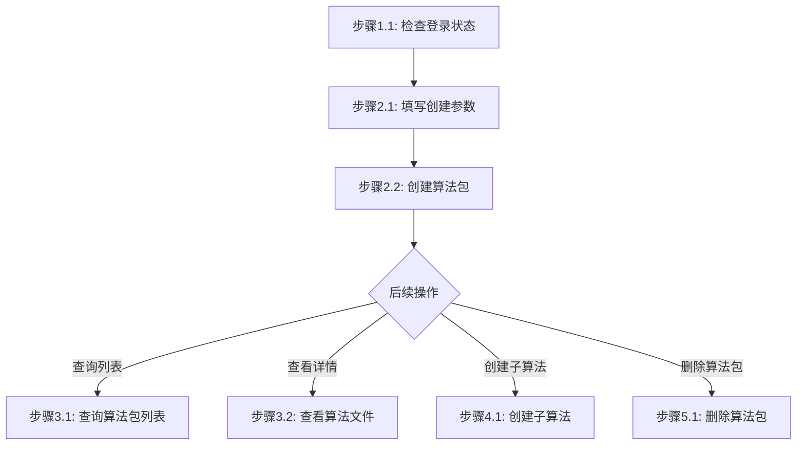

# 算法管理步骤

## 概述

本文件定义算法管理任务（创建算法包、fork子算法、查询、查看、删除）的执行步骤。

---

## 创建算法包

### 流程图



### 流程说明

- **阶段1-2**（准备工作、填写参数并创建）为**线性流程**，按顺序执行
- **阶段3-5**（查询列表、查看详情、创建子算法、删除算法包）为**非线性流程**，用户可根据需要独立调用

### 阶段1：准备工作

#### 步骤1.1：检查登录状态

```bash
jcc aitrain query --output text
```

如果命令因未授权失败，则执行登录：

```bash
$login = jcc login --username <username> --password <password> | ConvertFrom-Json
$env:JCC_TOKEN = $login.token
$env:JCC_USER_ID = $login.userID
$env:JCC_BASE_URL = "https://jcc.jointcloud.net"
```

### 阶段2：创建算法包

#### 步骤2.1：填写创建参数

| 参数 | 说明 | 示例 |
|------|------|------|
| name | 算法名称 | my-algo |
| path | 本地文件或目录路径 | ./code |

#### 步骤2.2：执行创建命令

```bash
jcc algo create \
  --name <name> \
  --path <path>
```

**示例**:
```bash
jcc algo create --name my-algo --path ./code
```

---

## 创建子算法

### 阶段1：准备工作

#### 步骤1.1：检查登录状态

同创建算法包步骤1.1

#### 步骤1.2：确认父算法包名称

```bash
jcc algo query --output text
```

#### 步骤1.3：查询目标集群

```bash
jcc algo cluster-list --output text
```

### 阶段2：创建子算法

#### 步骤2.1：执行fork命令

```bash
jcc algo fork \
  --parent-name <parent-name> \
  --cluster-name <cluster-name> \
  --description <description>
```

**示例**:
```bash
jcc algo fork --parent-name my-algo --cluster-name HPCSlurmArm --description my-algo-v2
```

---

## 查询算法包（独立可选操作）

**说明**: 查询操作与其他操作无先后依赖关系，可在任意时间单独执行。

### 查询列表

```bash
jcc algo query --output text
```

### 查询详情

```bash
jcc algo query --package-name <name> --output text
```

---

## 查看算法文件内容（独立可选操作）

**说明**: 查看操作与其他操作无先后依赖关系，可在任意时间单独执行。

### 查看父算法文件

```bash
jcc algo view --package-name <name>
```

### 查看子算法文件

```bash
jcc algo view --package-name <name> --description <description>
```

---

## 删除算法包（独立可选操作）

**说明**: 删除操作与其他操作无先后依赖关系，但删除前需通过查询确认算法包信息。

### 删除（需确认）

```bash
jcc algo delete --package-name <name>
```

### 强制删除（跳过确认）

```bash
jcc algo delete --package-name <name> --force
```

---

## 执行示例

```bash
# 登录
$login = jcc login --username admin --password mypass123 | ConvertFrom-Json
$env:JCC_TOKEN = $login.token
$env:JCC_USER_ID = $login.userID

# 查询可用集群
jcc algo cluster-list

# 创建算法包
jcc algo create --name my-algo --path ./code

# 查询算法包列表
jcc algo query

# 查询指定算法包详情
jcc algo query --package-name my-algo

# 查看算法文件
jcc algo view --package-name my-algo

# 创建子算法
jcc algo fork --parent-name my-algo --cluster-name HPCSlurmArm --description my-algo-v2

# 删除算法包
jcc algo delete --package-name my-algo --force
```