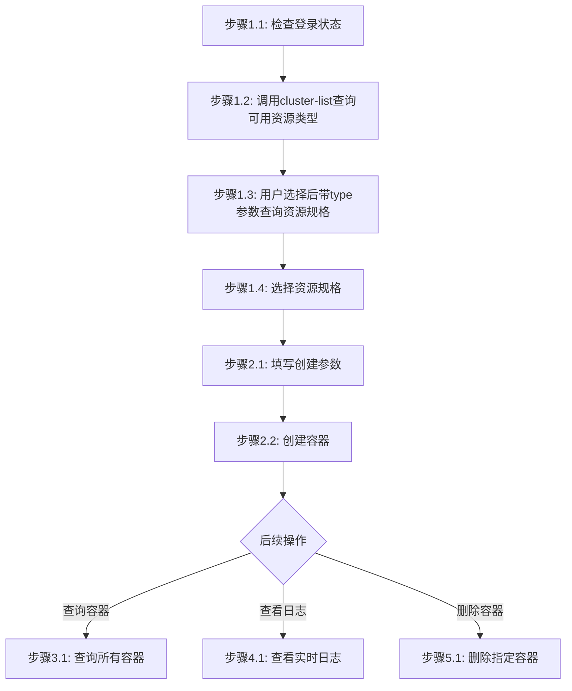
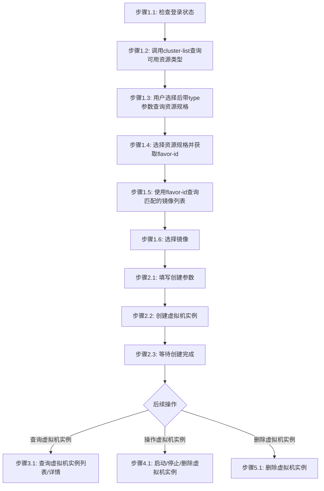

# 云算任务管理步骤

## 概述

本文件定义云算任务管理任务（容器/虚拟机实例）的执行步骤。

***

## 容器管理步骤

### 流程图



### 流程说明

- **阶段1-2**（准备工作、资源类型与规格选择、填写参数并创建容器）为**线性流程**，按顺序执行。只要用户表示需要创建容器，在完成登录和资源选择后，应自动进入填写创建参数和创建容器步骤。
- **阶段3-5**（查询容器、查看日志、删除容器）为**非线性流程**，用户可根据需要独立调用，**除非用户明确提及，否则不自动触发**。

### 阶段1：准备与资源选择

#### 步骤1.1：检查登录状态

```bash
# 尝试执行一个轻量命令验证登录状态
jcc aitrain query --output text
```

如果命令因未授权/缺少 token 失败，则执行登录并设置环境变量：

```bash
$login = jcc login --username <username> --password <password> | ConvertFrom-Json
$env:JCC_TOKEN = $login.token
$env:JCC_USER_ID = $login.userID
$env:JCC_BASE_URL = "https://jcc.jointcloud.net"
```

#### 步骤1.2：查询可用资源类型

调用查询接口获取平台当前支持的所有资源类型：

```bash
jcc cloudcontainer cluster-list --output text
```

从返回结果中提取可用的资源类型（如 TYPE 列），展示给用户并引导选择。

#### 步骤1.3：根据选定资源类型获取集群列表

根据用户选定的资源类型，带 `--type` 参数再次调用查询接口获取该类型下的可选集群列表：

```bash
jcc cloudcontainer cluster-list --type $resourceType --output text
```

**参数说明**:

- `--type`: 资源类型（可选，默认 CPU），支持 CPU/GPU

**输出示例**:

```
ID              Name              Status
-----           ----              ------
cluster-001     CPU-Cluster       active
cluster-002     GPU-Cluster       active
```

#### 步骤1.4：选择集群

从返回列表中选择一个集群并记录其名称：

```bash
$selectedCluster = "CPU-Cluster"
```

**说明**: 后续创建命令中的 `--cluster-name` 使用此值。

### 阶段2：填写创建参数并创建容器

#### 步骤2.1：填写创建参数

确认以下必填参数已准备就绪。资源规格（CPU/内存）可由步骤1.4已选规格自动带出，也可手动指定：

| 参数     | 说明                  | 示例           |
| ------ | ------------------- | ------------ |
| name   | 容器名称                | myapp        |
| image  | 镜像                  | nginx:latest |
| cpu    | CPU资源（可由已选资源规格自动带出） | 100          |
| memory | 内存资源（可由已选资源规格自动带出）  | 256          |

可选参数：

| 参数              | 说明                  | 默认值    |
| --------------- | ------------------- | ------ |
| port            | 端口                  | -      |
| replica         | 副本数                 | 1      |
| command         | 启动命令                | -      |
| args            | 启动参数（可多次）           | -      |
| env             | 环境变量 KEY=VALUE（可多次） | -      |
| description     | 描述                  | -      |
| mount-path      | 挂载路径                | -      |
| node-port       | 节点端口                | -      |
| container-group | 容器组名称               | 同 name |
| capacity        | 容量                  | -      |

#### 步骤2.2：执行创建命令

```bash
jcc cloudcontainer create \
  --cluster-name <cluster-name> \
  --name <name> \
  --image <image> \
  --cpu <cpu> \
  --memory <memory> \
  [--port <port>] \
  [--replica <replica>] \
  [--command <command>] \
  [--args <arg>] \
  [--env <key=value>] \
  [--description <description>]
```

**示例**:

```bash
jcc cloudcontainer create --cluster-name CPU-Cluster --name myapp --image nginx:latest --cpu 100 --memory 256 --port 8080 --replica 2
```

### 阶段3：查询容器

#### 步骤3.1：查询所有容器

```bash
jcc cloudcontainer query --page-num 1 --page-size 10 --output text
```

**可选过滤参数**:

| 参数            | 说明          | 默认值 | 示例                   |
| ------------- | ----------- | --- | -------------------- |
| `--name`      | 任务名称过滤      | -   | `--name mycontainer` |
| `--status`    | 任务状态过滤      | -   | `--status running`   |
| `--type`      | 任务类型过滤      | -   | `--type 1`           |
| `--page-num`  | 页码          | 1   | `--page-num 1`       |
| `--page-size` | 页大小         | 10  | `--page-size 10`     |
| `--id`        | 指定后查询单个容器详情 | -   | `--id container-001` |

**输出示例**:

```
ID              Name              Status    CreatedAt
-----           ----              ------    ----------
container-001   nginx-prod        running   2024-01-10T08:00:00Z
container-002   api-service       stopped   2024-01-08T10:30:00Z
```

**按条件查询示例**:

```bash
# 按名称过滤
jcc cloudcontainer query --name mycontainer --output text

# 按状态过滤
jcc cloudcontainer query --status running --page-num 1 --page-size 10 --output text

# 分页查询
jcc cloudcontainer query --page-num 1 --page-size 10 --output text
```

#### 步骤3.2：查询指定容器

```bash
jcc cloudcontainer query --id <container-id> --output text
```

**详情内容**:

- 容器ID、名称、状态
- 创建时间、运行时长
- 资源配置（CPU、内存）
- 网络配置

### 阶段4：查看容器日志

#### 步骤4.1：查看实时日志

```bash
jcc cloudcontainer log --name <container-name>
```

> 注意：需要在容器状态变为 Running 后才能查询日志，Pending 状态下会报 deployments.apps "xxx" not found 错误

**日志内容**:

- 容器启动日志
- 应用运行日志
- 错误和警告信息

### 阶段5：删除容器

#### 步骤5.1：删除指定容器

```bash
jcc cloudcontainer delete --name <container-name>
```

**确认删除**:

```bash
# 确认删除前建议先查询容器信息
jcc cloudcontainer query --name <container-name> --output text

# 确认后执行删除
jcc cloudcontainer delete --name <container-name>
```

***

## 虚拟机实例管理步骤

### 流程图



### 流程说明

- **阶段1-2**（准备工作、资源类型与规格选择、获取flavor-id、查询并选择镜像、填写参数并创建虚拟机实例）为**线性流程**，按顺序执行。只要用户表示需要创建虚拟机实例，在完成登录和资源选择后，应自动进入获取flavor-id、查询镜像、填写创建参数和创建虚拟机实例步骤。
- **阶段3-5**（查询虚拟机实例、操作虚拟机实例、删除虚拟机实例）为**非线性流程**，用户可根据需要独立调用，**除非用户明确提及，否则不自动触发**。

### 阶段1：准备与资源选择

#### 步骤1.1：检查登录状态

```bash
# 尝试执行一个轻量命令验证登录状态
jcc aitrain query --output text
```

如果命令因未授权/缺少 token 失败，则执行登录并设置环境变量：

```bash
$login = jcc login --username <username> --password <password> | ConvertFrom-Json
$env:JCC_TOKEN = $login.token
$env:JCC_USER_ID = $login.userID
$env:JCC_BASE_URL = "https://jcc.jointcloud.net"
```

#### 步骤1.2：查询可用资源类型

调用查询接口获取平台当前支持的所有资源类型：

```bash
jcc cloudinstance cluster-list --output text
```

从返回结果中提取可用的资源类型（如 TYPE 列），展示给用户并引导选择。

#### 步骤1.3：根据选定资源类型获取资源规格列表

根据用户选定的资源类型，带 `--type` 参数调用查询接口获取该类型下的资源规格列表（规格 ID/名称 + 集群信息）：

```bash
jcc cloudinstance cluster-list --type $resourceType --output text
```

**参数说明**:

- `--type`: 资源类型（可选，默认 CPU），支持 CPU/GPU

**输出示例**:

```
ID        NAME             TYPE  CPU    MEMORY  AVAIL  REGION          SOURCE KEY         CLUSTER NAME
14447504  CPU:1,内存:2GiB    CPU   1core  2gb     1/1    default         ecs.c1m2           电信私有云
14447503  CPU:1,内存:1GiB    CPU   1core  1gb     1/1    default         ecs.c1m1           电信私有云
341       CPU:1,内存:0.5GiB  CPU   1core  0.5gb   1/1    cn-zhangjiakou  ecs.t5-lc2m1.nano  阿里云
14447506  CPU:4,内存:8GiB    CPU   4core  8gb     1/1    default         ecs.c4m8           电信私有云
14447505  CPU:2,内存:4GiB    CPU   2core  4gb     1/1    default         ecs.c2m4           电信私有云
```

其中 `SOURCE KEY` 为底层云平台对应的实例规格标识（如阿里云的 `ecs.t5-lc2m1.nano`、电信私有云的 `ecs.c1m1` 等）。

#### 步骤1.4：选择资源规格并获取flavor-id

从返回列表中选择一个资源规格，记录其 `flavor-id`（ID列）、`sourceKey`（SOURCE KEY列）和集群名称：

```bash
$flavorId = "341"
$sourceKey = "ecs.t5-lc2m1.nano"
$selectedCluster = "阿里云"
```

**说明**:

- `flavor-id`（列表中的ID列）用于后续查询匹配的镜像
- `sourceKey`（列表中的SOURCE KEY列）用于创建命令的 `--instance-type` 参数
- `--cluster-name` 使用选中的集群名称

#### 步骤1.5：使用flavor-id查询匹配的镜像列表

使用步骤1.4获取的flavor-id，查询平台返回与该资源规格匹配的镜像列表：

```bash
jcc image list --flavor-id $flavorId --output text
```

**参数说明**:

- `--flavor-id`: 资源规格ID（必填，来自步骤1.4）
- `--page`: 分页页码（默认1）
- `--size`: 每页数量（默认10）

**输出示例**:

```
total: 3  page: 1  size: 10

=== 镜像列表 ===
ID   External ID                                     Name                                                  Tag  Kind  Provider  Status     Description                                     Created
658  ubuntu_20_04_uefi_x64_20G_alibase_20220324.vhd  ubuntu_20_04_uefi_x64_20G_alibase_20220324.vhd       vm    阿里云       available                                                  2026-02-06 02:22:23
654  ubuntu_18_04_uefi_x64_20G_alibase_20220330.vhd  ubuntu_18_04_uefi_x64_20G_alibase_20220330.vhd       vm    阿里云       available                                                  2026-02-06 02:22:23
297  ubuntu_20_04_x64_20G_alibase_20251031.vhd       ubuntu_20_04_x64_20G_alibase_20251031.vhd            vm    阿里云       available  Kernel version is 5.4.0-216-generic, 2025.11.3  2026-02-06 02:22:23
```

其中 `External ID` 为底层云平台的镜像标识（如阿里云镜像文件名），`Name` 为平台可见的镜像名称。

#### 步骤1.6：选择镜像

从返回的镜像列表中选择一个镜像，记录其 `External ID`：

```bash
$externalImageId = "ubuntu_20_04_x64_20G_alibase_20251031.vhd"
```

**说明**: 后续创建命令中的 `--image-id` 使用此值（External ID，非 ID 列值）。

### 阶段2：填写创建参数并创建虚拟机实例

#### 步骤2.1：准备创建参数

确认以下必填参数已准备就绪：

**必填参数**:

| 参数                 | 说明                              | 示例                                              | 来源    |
| ------------------ | ------------------------------- | ----------------------------------------------- | ----- |
| cluster\_name      | 目标集群名称（与cluster-id二选一）          | 阿里云                                             | 步骤1.4 |
| cluster\_id        | 集群ID（与cluster-name二选一）          | xxx                                             | 用户输入  |
| host\_name         | 主机名（主机名必须唯一，重复会导致创建失败，建议使用随机名称） | node-1                                          | 用户输入  |
| instance\_type     | 虚拟机实例类型（即sourceKey）             | ecs.t5-lc2m1.nano                               | 步骤1.4 |
| password           | 登录密码                            | MyPass123                                       | 用户输入  |
| image\_id          | 镜像标识（即External ID）              | ubuntu\_20\_04\_x64\_20G\_alibase\_20251031.vhd | 步骤1.6 |
| system\_disk\_size | 系统盘大小(GB)                       | 20                                              | 用户输入  |

**可选参数**:

| 参数                  | 说明    | 默认值        |
| ------------------- | ----- | ---------- |
| username            | 用户名   | root       |
| charge\_type        | 计费类型  | PostPaid   |
| disk\_category      | 系统盘类型 | cloud\_ssd |
| disk\_level         | 性能级别  | PL0        |
| replica             | 副本数   | 1          |
| security\_group\_id | 安全组ID | -          |

#### 步骤2.2：执行创建命令

```bash
jcc cloudinstance create \
  --cluster-name <cluster-name> \
  --host-name <host-name> \
  --instance-type <sourceKey> \
  --password <password> \
  --image-id <externalImageId> \
  --system-disk-size <size> \
  [--cluster-id <cluster-id>] \
  [--username <username>] \
  [--charge-type <charge-type>] \
  [--disk-category <disk-category>] \
  [--disk-level <disk-level>] \
  [--replica <replica>] \
  [--security-group-id <security-group-id>]
```

**示例**:

```bash
jcc cloudinstance create --cluster-name "阿里云" --host-name node-1 --instance-type ecs.t5-lc2m1.nano --password MyPass123 --image-id ubuntu_20_04_x64_20G_alibase_20251031.vhd --system-disk-size 20 --username root --charge-type PostPaid --disk-category cloud_ssd --disk-level PL0 --replica 1
```

#### 步骤2.3：等待创建完成

```bash
# 轮询查询虚拟机实例状态
jcc cloudinstance query --host-name <host-name> --output text
```

**状态说明**:

| 状态         | 说明       |
| ---------- | -------- |
| `pending`  | 等待创建     |
| `creating` | 正在创建     |
| `running`  | 创建完成，运行中 |
| `failed`   | 创建失败     |

### 阶段3：查询虚拟机实例

#### 步骤3.1：查询所有虚拟机实例

```bash
jcc cloudinstance query --output text
```

**可选过滤参数**:

| 参数            | 说明                            | 默认值 | 示例                   |
| ------------- | ----------------------------- | --- | -------------------- |
| `--host-name` | 主机名过滤（不带分页参数时查询详情，带分页参数时过滤列表） | -   | `--host-name node-1` |
| `--status`    | 状态过滤                          | -   | `--status running`   |
| `--page-num`  | 页码                            | 1   | `--page-num 1`       |
| `--page-size` | 页大小                           | 10  | `--page-size 10`     |

**输出示例**:

```
ID              HostName         Status    IP Address
-----           --------         ------    ----------
instance-001    node-1           running   192.168.1.101
instance-002    node-2           stopped   192.168.1.102
```

#### 步骤3.2：按条件筛选

```bash
# 按主机名筛选（不带分页参数时返回详情）
jcc cloudinstance query --host-name <host-name> --output text

# 按主机名筛选（带分页参数时按主机名过滤列表）
jcc cloudinstance query --host-name <host-name> --page-num 1 --page-size 10 --output text

# 按状态筛选
jcc cloudinstance query --status running --output text

# 组合筛选
jcc cloudinstance query --host-name node-1 --status running --output text
```

#### 步骤3.3：查询指定虚拟机实例详情

```bash
jcc cloudinstance query --host-name <host-name> --output text
```

**详情内容**:

- 虚拟机实例ID、主机名、状态
- IP地址（公网/私网）
- 资源配置（CPU、内存、磁盘）
- 创建时间、运行时长

### 阶段4：操作虚拟机实例

#### 步骤4.1：启动虚拟机实例

```bash
jcc cloudinstance operate --host-name <host-name> --operate-type start
```

#### 步骤4.2：停止虚拟机实例

```bash
jcc cloudinstance operate --host-name <host-name> --operate-type stop
```

#### 步骤4.3：删除虚拟机实例

```bash
jcc cloudinstance operate --host-name <host-name> --operate-type delete
```

#### 步骤4.4：操作状态验证

```bash
# 操作后查询状态
jcc cloudinstance query --host-name <host-name> --output text
```

## 执行示例

```bash
# === 容器管理 ===
# 登录
$login = jcc login --username admin --password mypass123 | ConvertFrom-Json
$env:JCC_TOKEN = $login.token
$env:JCC_USER_ID = $login.userID

# 创建容器
jcc cloudcontainer create --cluster-name CPU-Cluster --name nginx-prod --image nginx:latest --cpu 100 --memory 256 --port 80 --replica 1

# 查询所有容器
jcc cloudcontainer query --page-num 1 --page-size 10 --output text

# 查看容器日志
jcc cloudcontainer log --name nginx-prod

# 删除容器
jcc cloudcontainer delete --name nginx-prod

# === 虚拟机实例管理 ===
# 1. 查询可用资源规格列表（获取flavor-id和sourceKey）
jcc cloudinstance cluster-list --type CPU --output text

# 2. 使用flavor-id查询匹配的镜像列表
jcc image list --flavor-id 341 --output text

# 3. 创建虚拟机实例（--instance-type用sourceKey，--image-id用External ID）
jcc cloudinstance create --cluster-name "阿里云" --host-name node-1 --instance-type ecs.t5-lc2m1.nano --password MyPass123 --image-id ubuntu_20_04_x64_20G_alibase_20251031.vhd --system-disk-size 20

# 查询所有运行中虚拟机实例
jcc cloudinstance query --status running --output text

# 查询指定虚拟机实例
jcc cloudinstance query --host-name node-1 --output text

# 启动虚拟机实例
jcc cloudinstance operate --host-name node-2 --operate-type start

# 停止虚拟机实例
jcc cloudinstance operate --host-name node-1 --operate-type stop

# 删除虚拟机实例
jcc cloudinstance operate --host-name node-1 --operate-type delete
```

