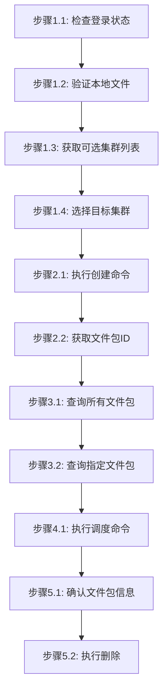

# 个人文件管理步骤

## 概述

本文件定义个人文件管理任务的执行步骤，包括创建文件包、查询、调度和删除操作。

---

## 创建文件包

### 流程图



### 阶段1：准备工作

#### 步骤1.1：检查登录状态

```bash
$login = jcc login --username <username> --password <password> | ConvertFrom-Json
$env:JCC_TOKEN = $login.token
$env:JCC_USER_ID = $login.userID
```

#### 步骤1.2：验证本地文件

```bash
# 确认本地文件路径存在
Test-Path -Path <local-files-path>
```

**文件包内容示例**:
```
files/
├── data/
│   ├── input.txt
│   └── config.yaml
├── script.py
└── README.md
```

#### 步骤1.3：获取可选集群列表

查询支持文件存储调度的集群列表：

```bash
jcc commonfile cluster-list --output text
```

**输出示例**:
```
ID              Name              Status
-----           ----              ------
HPCSlurmArm     HPC-Slurm-Arm     active
HPCSlurmX86     HPC-Slurm-X86     active
```

#### 步骤1.4：选择目标集群

基于返回的集群列表选择目标集群，并记录集群名称/ID：

```bash
$selectedCluster = "<cluster-name>"
```

**说明**: `<cluster-name>` 为从上述列表中选择的实际集群标识。

### 阶段2：创建文件包

#### 步骤2.1：执行创建命令

```bash
jcc commonfile create \
  --name <package-name> \
  --path <local-path> \
  --cluster-name <cluster-name>
```

**参数说明**:
- `--name`: 文件包名称（必填），用于标识文件包
- `--path`: 本地文件路径（必填），包含所有文件的目录
- `--cluster-name`: 目标集群名称（必填），如 HPCSlurmArm

**示例**:
```bash
jcc commonfile create --name my-data-package --path ./my-files/ --cluster-name HPCSlurmArm
```

#### 步骤2.2：获取文件包ID

创建成功后返回文件包信息：

```json
{
  "id": "package-123456",
  "name": "my-data-package",
  "status": "uploading",
  "clusterName": "HPCSlurmArm"
}
```

### 阶段3：查询文件包

#### 步骤3.1：查询所有文件包

```bash
jcc commonfile query --output text
```

**输出示例**:
```
PACKAGE ID      NAME              STATUS     CLUSTER
-----------     ----              ------     -------
package-001     my-data-package   ready      HPCSlurmArm
package-002     backup-files      ready      HPCSlurmX86
```

#### 步骤3.2：查询指定文件包

```bash
jcc commonfile query --package-name <package-name>
```

**详情内容**:
- 文件包ID、名称、状态
- 目标集群名称
- 文件数量、总大小
- 创建时间

### 阶段4：调度文件包到集群

#### 步骤4.1：执行调度命令

```bash
jcc commonfile schedule \
  --cluster-name <cluster-name> \
  [--package-name <package-name>]
```

**参数说明**:
- `--cluster-name`: 目标集群名称（必填）
- `--package-name`: 文件包名称（可选）

**示例**:
```bash
jcc commonfile schedule --cluster-name cluster-01 --package-name my-data-package
```

### 阶段5：删除文件包

#### 步骤5.1：确认文件包信息

```bash
jcc commonfile query --package-name <package-name>
```

#### 步骤5.2：执行删除

```bash
jcc commonfile delete --package-name <package-name>
```

**确认删除**:
```bash
# 确认后执行删除
jcc commonfile delete --package-name my-package
```

## 执行示例

```bash
# 登录
$login = jcc login --username admin --password mypass123 | ConvertFrom-Json
$env:JCC_TOKEN = $login.token
$env:JCC_USER_ID = $login.userID

# 创建文件包
jcc commonfile create --name my-package --path ./my-files/ --cluster-name HPCSlurmArm

# 查询文件包列表
jcc commonfile query --output text

# 查询指定文件包
jcc commonfile query --package-name my-package

# 调度文件包
jcc commonfile schedule --cluster-name cluster-01 --package-name my-package

# 删除文件包
jcc commonfile delete --id package-xxx
```

