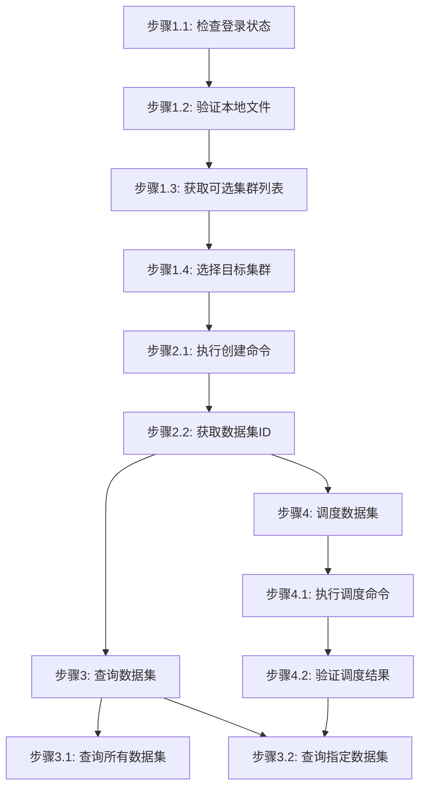

# 数据集管理步骤

## 概述

本文件定义数据集管理任务的执行步骤。

***

## 创建数据集

### 流程图



### 流程说明

- **阶段1-2**（准备工作、创建数据集）为**线性流程**，按顺序执行
- **阶段3-4**（查询数据集、调度数据集）为**非线性流程**，用户可根据需要独立调用

### 阶段1：准备工作

#### 步骤1.1：检查登录状态

```bash
$login = jcc login --username <username> --password <password> | ConvertFrom-Json
$env:JCC_TOKEN = $login.token
$env:JCC_USER_ID = $login.userID
```

#### 步骤1.2：验证本地文件

```bash
# 确认本地数据路径存在
Test-Path -Path <local-data-path>
```

**预期输出**:

- `True`: 路径存在
- `False`: 路径不存在，需要创建或修正路径

#### 步骤1.3：获取可选集群列表

查询支持数据集存储调度的集群列表：

```bash
jcc dataset cluster-list --output text
```

**输出示例**:

```
ID              Name              Status
-----           ----              ------
cluster-001     AI-Cluster        active
cluster-002     HPC-Cluster       active
```

#### 步骤1.4：选择目标集群

基于返回的集群列表选择目标集群，并记录集群名称：

```bash
$selectedCluster = "<cluster-name>"
```

**说明**: `<cluster-name>` 为从上述列表中选择的实际集群名称。

### 阶段2：创建数据集

#### 步骤2.1：执行创建命令

```bash
jcc dataset create \
  --name <dataset-name> \
  --path <local-path> \
  [--clusters <cluster-name> ...]
```

**参数说明**:

- `--name`: 数据集名称（必填），用于标识数据集
- `--path`: 本地数据路径（必填），可以是文件或目录
- `--clusters`: 目标集群名称（可选，可指定多个）

**示例**:

```bash
jcc dataset create --name cifar10-dataset --path ./data/cifar10/ --clusters ai-cluster-01 ai-cluster-02
```

#### 步骤2.2：获取数据集ID

创建成功后返回数据集信息：

```json
{
  "id": "dataset-123456",
  "name": "cifar10-dataset",
  "status": "uploading"
}
```

### 阶段3：查询数据集（独立可选操作）

**说明**: 查询操作与调度操作无先后依赖关系，可在任意时间单独执行。

#### 步骤3.1：查询所有数据集

```bash
jcc dataset query --output text
```

**输出示例**:

```
PACKAGE ID      NAME              STATUS     SIZE
-----------     ----              ------     ----
dataset-001     cifar10-dataset   ready      1.2GB
dataset-002     imagenet-train    uploading  150GB
```

#### 步骤3.2：查询指定数据集

```bash
jcc dataset query --package-name <dataset-name>
```

**详情内容**:

- 数据集ID、名称、状态
- 文件数量、总大小
- 创建时间、更新时间
- 关联集群列表

### 阶段4：调度数据集到集群（独立可选操作）

**说明**: 调度操作与查询操作无先后依赖关系，但调度前需通过查询获取数据集ID。调度后可通过查询验证结果。

#### 步骤4.1：执行调度命令

```bash
jcc dataset schedule \
  --cluster-name <cluster-name> \
  [--package-name <dataset-name>]
```

**参数说明**:

- `--cluster-name`: 目标集群名称（必填）
- `--package-name`: 数据集名称（可选）

**示例**:

```bash
jcc dataset schedule --cluster-name ai-cluster-01 --package-name cifar10-dataset
```

#### 步骤4.2：验证调度结果

```bash
jcc dataset query --package-name <dataset-name>
```

**状态说明**:

| 状态           | 说明       |
| ------------ | -------- |
| `uploading`  | 上传中      |
| `ready`      | 准备就绪     |
| `scheduling` | 调度中      |
| `synced`     | 已同步到目标集群 |

***

## 删除数据集

### 步骤1：确认数据集信息

```bash
jcc dataset query --package-name <dataset-name>
```

### 步骤2：执行删除

```bash
# 注意：jcc dataset 命令未提供删除功能，如需删除请联系管理员
```

## 执行示例

```bash
# 登录
$login = jcc login --username admin --password mypass123 | ConvertFrom-Json
$env:JCC_TOKEN = $login.token
$env:JCC_USER_ID = $login.userID

# 创建数据集（必须步骤）
jcc dataset create --name my-dataset --path ./data/training/ --clusters ai-cluster-01

# === 以下操作独立可选，可按需执行，无固定顺序 ===

# 示例1：查询数据集列表（独立操作）
jcc dataset query --output text

# 示例2：查询指定数据集（独立操作，可用于获取数据集信息）
jcc dataset query --package-name my-dataset

# 示例3：调度数据集到集群（独立操作，需先通过查询获取数据集名称）
jcc dataset schedule --cluster-name ai-cluster-01 --package-name my-dataset

# 示例4：调度后查询验证结果（调度与查询组合使用）
jcc dataset query --package-name my-dataset
```

