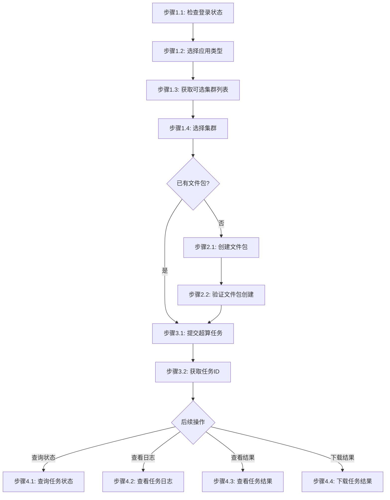

# 超算任务步骤

## 概述

本文件定义提交超算任务的执行步骤。超算任务用于执行大规模科学计算，如 VASP、CFD 模拟等。

## 前置工具阶段：准备工作（非线性，独立调用）

以下工具命令可在任务提交前后独立使用，**除非用户明确提及，否则不自动触发**。

### 工具1：查询可用集群

根据应用类型查询支持该应用的 HPC 集群列表：

```bash
jcc hpc cluster-list --apptype <application-type>
```

**参数说明**:

- `--apptype`: 应用类型（必填），如 vasp、lammps

**示例**:

```bash
jcc hpc cluster-list --apptype vasp
jcc hpc cluster-list --apptype lammps
```

**输出示例**:

```bash
Cluster: HPCSlurmArm, Status: active, Nodes: 64
Cluster: HPCSlurmX86, Status: active, Nodes: 32
```

### 工具2：生成 VASP 输入文件

将本地 POSCAR 文件上传至 VASPKIT 接口，生成 INCAR / KPOINTS / POTCAR 并保存到 POSCAR 所在目录：

```bash
jcc hpc vaspkit --path <poscar-file-path>
```

**参数说明**:

- `--path`: POSCAR 文件路径（必填），需为本地绝对路径

**示例**:

```bash
jcc hpc vaspkit --path "D:\\materials\\POSCAR"
```

**生成文件**:

- `INCAR` — VASP 计算参数文件
- `KPOINTS` — K 点设置文件
- `POTCAR` — 赝势文件

### 工具3：预测 POSCAR 结构能量

将本地 POSCAR 文件上传至 ALIGNN 接口进行能量值预测：

```bash
jcc hpc predict --path <poscar-file-path>
```

**参数说明**:

- `--path`: POSCAR 文件路径（必填），需为本地绝对路径

**示例**:

```bash
jcc hpc predict --path "D:\\materials\\POSCAR"
```

**返回结果**:

- 预测的能量值（eV）
- 可用于验证结构合理性

***

## 任务提交流程

### 流程图



### 流程说明

- **阶段1**（准备工作）的线性关系为：先选择应用类型，再根据应用类型过滤返回可选集群列表，用户选择集群后再填写创建信息。
- **阶段2-3**（创建文件包、提交任务）为**线性流程**，按顺序执行；如已有文件包，可跳过阶段2直接进入阶段3。
- **阶段4**（查询状态、查看日志、查看结果、下载结果）为**非线性流程**，用户可根据需要独立调用，**除非用户明确提及，否则不自动触发**

### 阶段1：准备工作

#### 步骤1.1：检查登录状态

```bash
# 尝试执行一个轻量命令验证登录状态
jcc aitrain query --output text
```

如果命令因未授权/缺少 token 失败，则执行登录并设置环境变量：

```bash
$login = jcc login --username <username> --password <password> | ConvertFrom-Json
$env:JCC_TOKEN = $login.token
$env:JCC_USER_ID = $login.userID
$env:JCC_BASE_URL = "https://jcc.jointcloud.net"
```

#### 步骤1.2：选择应用类型

在提交超算任务前，先确定应用类型（如 vasp、lammps）：

```bash
# 应用类型变量，例如 vasp 或 lammps
$appType = "vasp"
```

#### 步骤1.3：获取可选集群列表

根据应用类型过滤返回支持该应用的集群列表：

```bash
jcc hpc cluster-list --apptype $appType
```

#### 步骤1.4：选择集群

从步骤1.3返回的集群列表中选择目标集群：

```bash
$selectedCluster = "HPCSlurmArm"
```

**说明**: 主流程中，用户需先选择应用类型，再获取并选择集群，之后填写创建信息。

### 阶段2：创建 HPC 文件包（如已有包可跳过此阶段）

#### 步骤2.1：创建文件包

```bash
jcc commonfile create \
  --name <package-name> \
  --path <local-files-path> \
  --cluster-name <cluster-name>
```

**参数说明**:

- `--name`: 文件包名称（必填）
- `--path`: 本地文件路径（必填）
- `--cluster-name`: 目标集群名称（必填）

**示例**:

```bash
jcc commonfile create --name vasp-test-data --path ./vasp-input/ --cluster-name HPCSlurmArm
```

#### 步骤2.2：验证文件包创建

```bash
jcc commonfile query --id <package-id> --output text
```

### 阶段3：提交超算任务

#### 步骤3.1：提交任务

根据应用类型区分两套流程：
- **VASP 流程**: 查集群 -> 查包 -> 校验文件(POSCAR/INCAR/KPOINTS/POTCAR) -> 提交任务
- **非 VASP 流程**: 查集群 -> 查包 -> 查文件 objectID -> 提交任务（需 `--file-name`）

```bash
jcc hpc create \
  --name <task-name> \
  --cluster-name <cluster-name> \
  --package-name <package-name> \
  --apptype <application-type> \
  [--file-name <file-name>] \
  [--nodes <number>] \
  [--ntasks <number>] \
  [--param <key=value>]
```

**参数说明**:

- `--name`: 任务名称（必填），用于标识任务
- `--cluster-name`: 目标集群名称（必填），如 HPCSlurmArm
- `--package-name`: 已有包名称（必填），包含输入数据和脚本
- `--apptype`: 应用类型（必填），如 vasp、lammps 等
- `--file-name`: 包内文件名（非 VASP 应用必填），VASP 应用无需此参数
- `--nodes`: 计算节点数量（可选，默认1）
- `--ntasks`: 每个节点任务数（可选，默认4）
- `--param`: 运行参数 KEY=VALUE（可选，可多次）

**示例**:

```bash
# VASP 应用（自动校验 POSCAR/INCAR/KPOINTS/POTCAR）
jcc hpc create --name vasp-calculation-001 --cluster-name HPCSlurmArm --package-name vasp-test-data --apptype vasp --nodes 2 --ntasks 8

# 非 VASP 应用（如 lammps，需指定 --file-name）
jcc hpc create --name lammps-task-001 --cluster-name HPCSlurmArm --package-name lammps-pkg --apptype lammps --file-name in.min
```

#### 步骤3.2：获取任务ID

任务提交成功后会返回任务信息：

```bash
{
  "taskId": "hpc-1234567890",
  "name": "vasp-calculation-001",
  "status": "pending"
}
```

### 阶段4：监控任务状态

#### 步骤4.1：查询任务状态

```bash
jcc hpc status --task-name <task-name> --output text
```

**参数说明**:

- `--task-name`: 任务名称（必填），提交任务时指定的名称

> 注意：`jcc hpc status` 实际返回的是任务详情（含运行状态）。

**状态说明**:

| 状态          | 说明   |
| ----------- | ---- |
| `pending`   | 等待调度 |
| `running`   | 运行中  |
| `completed` | 已完成  |
| `failed`    | 失败   |
| `cancelled` | 已取消  |

#### 步骤4.2：查看任务日志

```bash
jcc hpc log --task-name <task-name>
```

**参数说明**:

- `--task-name`: 任务名称（必填）

> 注意：`jcc hpc log` 实际返回的是任务的 stdout/stderr 日志输出。

**内容**:

- stdout 日志
- stderr 日志

#### 步骤4.3：查看任务结果

```bash
jcc hpc result --task-name <task-name>
```

**参数说明**:

- `--task-name`: 任务名称（必填）

**结果内容**:

- 输出文件列表
- 文件大小
- 创建时间

#### 步骤4.4：下载任务结果

任务完成后，可将结果文件打包下载到本地：

```bash
jcc hpc result download --task-name <task-name> [--output <path>]
```

**参数说明**:

- `--task-name`: 任务名称（必填）
- `--output`: 输出文件路径（可选，默认为 `<task-name>.zip`）

**示例**:

```bash
# 下载到默认路径
jcc hpc result download --task-name vasp-calculation

# 指定输出路径
jcc hpc result download --task-name vasp-calculation --output ./result.zip
```

## 执行示例

### VASP 应用示例

```bash
# 登录
$login = jcc login --username admin --password mypass123 | ConvertFrom-Json
$env:JCC_TOKEN = $login.token
$env:JCC_USER_ID = $login.userID

# 查询可用集群
jcc hpc cluster-list --apptype vasp

# 创建文件包（如已有则跳过）
jcc commonfile create --name vasp-test-data --path ./vasp-input/ --cluster-name HPCSlurmArm

# 提交超算任务（VASP 自动校验 POSCAR/INCAR/KPOINTS/POTCAR）
jcc hpc create --name vasp-calc-001 --cluster-name HPCSlurmArm --package-name vasp-test-data --apptype vasp

# 查看任务状态（实时日志）
jcc hpc status --task-name vasp-calc-001 --output text

# 查看任务详情
jcc hpc log --task-name vasp-calc-001

# 查看任务结果
jcc hpc result --task-name vasp-calc-001

# 下载任务结果（打包为 zip）
jcc hpc result download --task-name vasp-calc-001 --output ./result.zip
```

### 非 VASP 应用示例（如 lammps）

```bash
# 登录
$login = jcc login --username admin --password mypass123 | ConvertFrom-Json
$env:JCC_TOKEN = $login.token
$env:JCC_USER_ID = $login.userID

# 查询可用集群
jcc hpc cluster-list --apptype lammps

# 创建文件包（如已有则跳过）
jcc commonfile create --name lammps-pkg --path ./lammps-input/ --cluster-name HPCSlurmArm

# 提交超算任务（非 VASP 需指定 --file-name）
jcc hpc create --name lammps-calc-001 --cluster-name HPCSlurmArm --package-name lammps-pkg --apptype lammps --file-name in.min

# 后续监控命令与 VASP 一致
jcc hpc status --task-name lammps-calc-001 --output text
jcc hpc log --task-name lammps-calc-001
jcc hpc result --task-name lammps-calc-001
jcc hpc result download --task-name lammps-calc-001 --output ./lammps-result.zip
```

> **注意**：VASP 输入文件生成（`jcc hpc vaspkit`）和能量预测（`jcc hpc predict`）是独立的前置工具命令，仅在用户明确需要时调用，不属于任务提交的线性流程。

