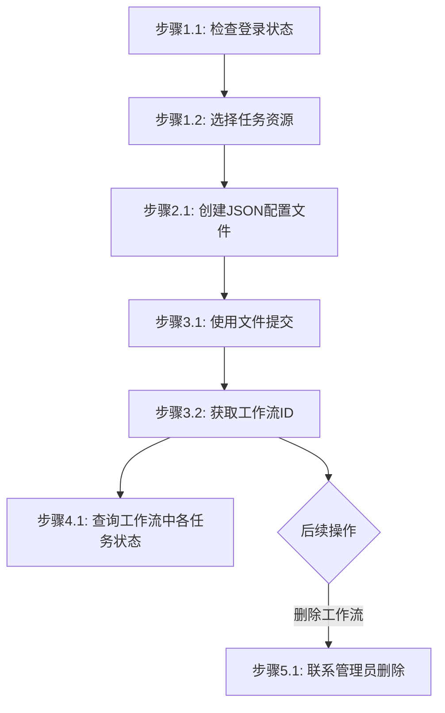

# 工作流管理步骤

## 概述

本文件定义工作流（JobSet）提交任务的执行步骤。工作流用于提交一组相关联的任务，支持任务间的依赖关系和并行执行。

---

## 提交工作流

### 流程图



### 流程说明

- **阶段1-3**（准备工作、创建配置、提交工作流）为**线性流程**，按顺序执行。
- **阶段4-5**（查询任务状态、删除工作流）为**非线性流程**，用户可根据需要独立调用，**除非用户明确提及，否则不自动触发**。  

### 阶段1：准备工作

#### 步骤1.1：检查登录状态

```bash
# 尝试执行一个轻量命令验证登录状态
jcc aitrain query --output text
```

如果命令因未授权/缺少 token 失败，则执行登录并设置环境变量：

```bash
$login = jcc login --username <username> --password <password> | ConvertFrom-Json
$env:JCC_TOKEN = $login.token
$env:JCC_USER_ID = $login.userID
$env:JCC_BASE_URL = "https://jcc.jointcloud.net"
```

#### 步骤1.2：选择任务资源

根据工作流中任务类型直接配置资源：

```bash
$hpcResource = "HPCSlurmArm"
$trainResource = "GPU:A100:8"
```

**说明**: 资源配置将在工作流JSON文件中指定

### 阶段2：准备工作流配置

#### 步骤2.1：创建JSON配置文件

创建 `workflow.json` 文件：

```json
{
  "name": "my-workflow",
  "description": "Batch processing workflow",
  "jobs": [
    {
      "name": "job-1",
      "type": "hpc",
      "parameters": {
        "clusterName": "HPCSlurmArm",
        "packageName": "input-data-001",
        "apptype": "vasp"
      },
      "dependencies": []
    },
    {
      "name": "job-2",
      "type": "hpc",
      "parameters": {
        "clusterName": "HPCSlurmArm",
        "packageName": "input-data-002",
        "apptype": "vasp"
      },
      "dependencies": ["job-1"]
    }
  ]
}
```

**配置字段说明**:
- `name`: 工作流名称（必填）
- `description`: 描述（可选）
- `jobs`: 任务列表（必填）
  - `name`: 任务名称（必填）
  - `type`: 任务类型（必填），如 `hpc`, `train`, `inference`
  - `parameters`: 任务参数（必填），根据任务类型不同而变化
  - `dependencies`: 依赖任务列表（可选）

### 阶段3：提交工作流

#### 步骤3.1：使用文件提交

```bash
jcc jobset submit --data-file ./workflow.json
```

#### 步骤3.2：使用JSON字符串提交

```bash
jcc jobset submit --data '{"name": "my-workflow", "jobs": [...]}'
```

#### 步骤3.3：获取工作流ID

提交成功后返回工作流信息：

```json
{
  "jobSetId": "workflow-123456",
  "name": "my-workflow",
  "status": "pending",
  "jobCount": 2
}
```

### 阶段4：监控工作流状态

#### 步骤4.1：查询工作流中各任务状态

工作流提交后，每个任务会生成独立的任务ID。根据任务类型使用对应的命令查询：

```bash
# 查询超算任务状态
jcc hpc status --task-name <task-name> --output text

# 查询训练任务列表
jcc aitrain query --output text

# 查询推理任务列表
jcc aiinfer query --output text
```

**状态说明**:
| 状态 | 说明 |
|------|------|
| `pending` | 等待调度 |
| `running` | 执行中 |
| `completed` | 已完成 |
| `failed` | 失败 |

---

## 删除工作流

### 步骤1：确认工作流信息

根据工作流中的任务类型使用对应的命令查询：

```bash
# 查询超算任务状态
jcc hpc status --task-name <task-name> --output text

# 查询训练任务列表
jcc aitrain query --output text
```

### 步骤2：执行删除

```bash
# 注意：jcc jobset 命令未提供删除功能，如需删除请联系管理员
```

## 执行示例

```bash
# 登录
$login = jcc login --username admin --password mypass123 | ConvertFrom-Json
$env:JCC_TOKEN = $login.token
$env:JCC_USER_ID = $login.userID

# 创建工作流配置文件
# 编辑 workflow.json 文件

# 提交工作流
jcc jobset submit --data-file ./workflow.json

# 监控工作流中各任务状态
jcc hpc status --task-name <task-name> --output text
jcc aitrain query --output text
jcc aiinfer query --output text
```

