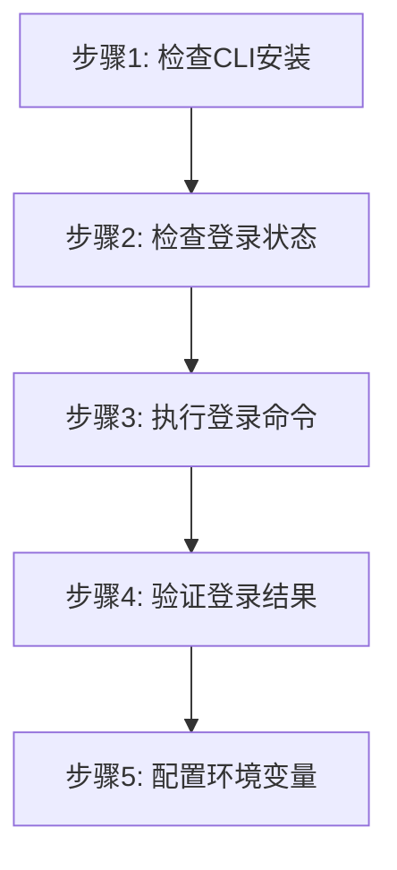

# 登录任务步骤

## 概述

本文件定义登录云际平台的执行步骤。

## 执行步骤

### 流程图



### 步骤1：检查 jcc CLI 是否安装

```bash
jcc --version
```

**预期输出**:
- 如果已安装：显示版本信息，如 `jcc version 1.0.0`
- 如果未安装：提示 "jcc : 无法将 'jcc' 项识别为 cmdlet、函数、脚本文件或可运行程序的名称"

### 步骤2：检查当前登录状态

```bash
# 尝试执行一个轻量命令验证登录状态
jcc aitrain query --output text
```

如果命令因未授权/缺少 token 失败，则执行登录并设置环境变量：

```bash
$login = jcc login --username <username> --password <password> | ConvertFrom-Json
$env:JCC_TOKEN = $login.token
$env:JCC_USER_ID = $login.userID
$env:JCC_BASE_URL = "https://jcc.jointcloud.net"
```

**说明**:
- 通过执行实际的轻量查询命令来验证登录状态
- 如果已登录：命令返回查询结果
- 如果未登录：命令失败，需执行登录并配置环境变量

### 步骤3：执行登录命令

```bash
jcc login --username <username> --password <password>
```

**参数说明**:
- `--username`: 用户名（必填，默认值为 admin）
- `--password`: 密码（必填）
- `--base-url`: 服务端地址（可选，默认 https://jcc.jointcloud.net）

**示例**:
```bash
jcc login --username admin --password mypass123
```

### 步骤4：验证登录结果

登录成功后会返回 JSON 格式的 token 和 userID：

```json
{
  "token": "eyJhbGciOiJIUzI1NiIsInR5cCI6IkpXVCJ9...",
  "userID": 123
}
```

### 步骤5：配置环境变量（推荐）

为了后续命令无需重复输入 token，可以设置环境变量：

**Windows PowerShell**:
```powershell
$login = jcc login --username admin | ConvertFrom-Json
$env:JCC_TOKEN = $login.token
$env:JCC_USER_ID = $login.userID
$env:JCC_BASE_URL = "https://jcc.jointcloud.net"
```

**验证配置**:
```bash
jcc aitrain query --output text
```


## 执行示例

```bash
# 登录并保存凭证到变量
$login = jcc login --username admin --password mypass123 | ConvertFrom-Json

# 设置环境变量
$env:JCC_TOKEN = $login.token
$env:JCC_USER_ID = $login.userID

# 验证登录成功
jcc aitrain query --output text
```