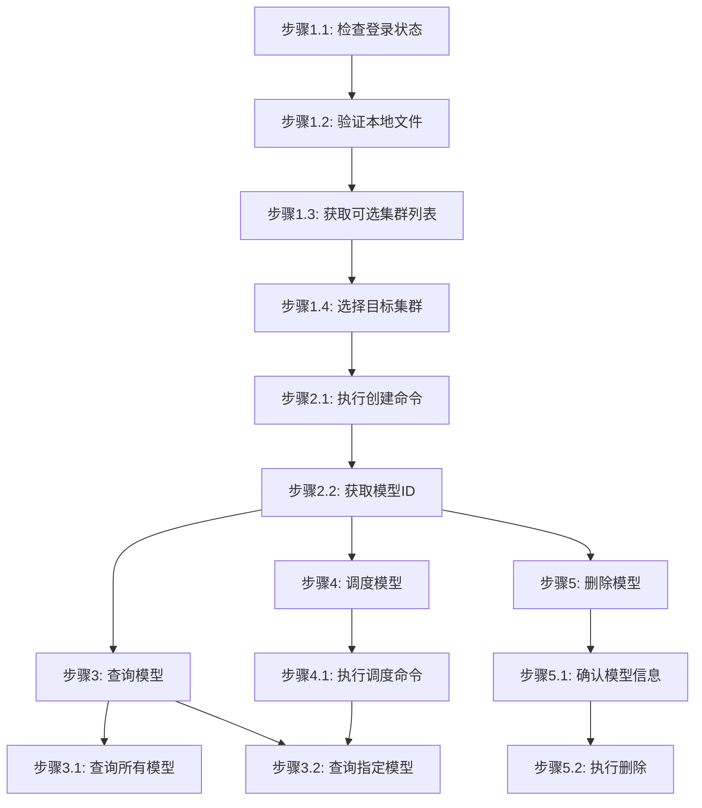

# 模型管理步骤

## 概述

本文件定义模型管理任务的执行步骤。

---

## 创建模型

### 流程图



### 流程说明

- **阶段1-2**（准备工作、创建模型）为**线性流程**，按顺序执行
- **阶段3-5**（查询模型、调度模型、删除模型）为**非线性流程**，用户可根据需要独立调用

### 阶段1：准备工作

#### 步骤1.1：检查登录状态

```bash
$login = jcc login --username <username> --password <password> | ConvertFrom-Json
$env:JCC_TOKEN = $login.token
$env:JCC_USER_ID = $login.userID
```

#### 步骤1.2：验证本地模型文件

```bash
# 确认本地模型路径存在
Test-Path -Path <local-model-path>
```

**模型文件结构示例**:
```
model/
├── config.json
├── pytorch_model.bin
├── tokenizer.json
└── special_tokens_map.json
```

#### 步骤1.3：获取可选集群列表

查询支持模型存储调度的集群列表：

```bash
jcc model cluster-list --output text
```

**输出示例**:
```
ID              Name              Status
-----           ----              ------
cluster-001     AI-Cluster        active
cluster-002     HPC-Cluster       active
```

#### 步骤1.4：选择目标集群

基于返回的集群列表选择目标集群，并记录集群名称：

```bash
$selectedCluster = "<cluster-name>"
```

**说明**: `<cluster-name>` 为从上述列表中选择的实际集群名称。

### 阶段2：创建模型

#### 步骤2.1：执行创建命令

```bash
jcc model create \
  --name <model-name> \
  --path <local-path> \
  [--clusters <cluster-name> ...]
```

**参数说明**:
- `--name`: 模型名称（必填），用于标识模型
- `--path`: 本地模型路径（必填），包含模型文件的目录
- `--clusters`: 目标集群名称（可选，可指定多个）

**示例**:
```bash
jcc model create --name llama2-7b --path ./models/llama2-7b/ --clusters ai-cluster-01
```

#### 步骤2.2：获取模型ID

创建成功后返回模型信息：

```json
{
  "id": "model-123456",
  "name": "llama2-7b",
  "status": "uploading",
  "size": "13GB"
}
```

### 阶段3：查询模型（独立可选操作）

**说明**: 查询操作与调度、删除操作无先后依赖关系，可在任意时间单独执行。

#### 步骤3.1：查询所有模型

```bash
jcc model query --output text
```

**输出示例**:
```
PACKAGE ID      NAME              STATUS     SIZE
-----------     ----              ------     ----
model-001       llama2-7b         ready      13GB
model-002       bert-base         ready      418MB
```

#### 步骤3.2：查询指定模型

```bash
jcc model query --package-name <model-name>
```

**详情内容**:
- 模型ID、名称、状态
- 文件数量、总大小
- 创建时间、更新时间
- 关联集群列表

### 阶段4：调度模型到集群（独立可选操作）

**说明**: 调度操作与查询、删除操作无先后依赖关系，但调度前需通过查询获取模型ID。调度后可通过查询验证结果。

#### 步骤4.1：执行调度命令

```bash
jcc model schedule \
  --cluster-name <cluster-name> \
  [--package-name <model-name>]
```

**参数说明**:
- `--cluster-name`: 目标集群名称（必填）
- `--package-name`: 模型名称（可选）

**示例**:
```bash
jcc model schedule --cluster-name ai-cluster-01 --package-name llama2-7b
```

---

## 删除模型（独立可选操作）

**说明**: 删除操作与查询、调度操作无先后依赖关系，但删除前需通过查询确认模型信息。

### 步骤1：确认模型信息

```bash
jcc model query --package-name <model-name>
```

### 步骤2：执行删除

```bash
# 注意：jcc model 命令未提供删除功能，如需删除请联系管理员
```

## 错误处理

| 错误类型 | 错误信息 | 处理方式 |
|----------|----------|----------|
| 未登录 | 401 Unauthorized | 先执行 `jcc login` 登录，或使用自动重试机制 |
| 路径不存在 | Path not found | 确认本地路径正确，检查文件是否存在 |
| 集群不存在 | Cluster not found | 确认集群ID正确，使用多集群选择机制 |
| 模型损坏 | Corrupted model files | 使用模型校验函数检查完整性，重新上传 |
| 网络超时 | Connection timed out | 使用分片上传机制，实现断点续传 |
| 模型格式不支持 | Model format not supported | 使用兼容性检查函数预先验证 |
| 模型名称重复 | Model name already exists | 使用不同的模型名称，或添加版本号后缀 |
| 权限不足 | Permission denied | 确认用户具有上传权限，联系管理员申请 |
| 模型版本不兼容 | Model version incompatible | 使用兼容的模型版本，或选择支持的集群 |
| 部署失败 | Deployment failed | 使用版本回滚机制恢复到上一版本 |
| 存储空间不足 | Insufficient storage | 清理旧模型版本或联系管理员调整配额 |

## 执行示例

```bash
# 登录
$login = jcc login --username admin --password mypass123 | ConvertFrom-Json
$env:JCC_TOKEN = $login.token
$env:JCC_USER_ID = $login.userID

# 创建模型（必须步骤）
jcc model create --name my-model --path ./models/bert-base/ --clusters ai-cluster-01

# === 以下操作独立可选，可按需执行，无固定顺序 ===

# 示例1：查询模型列表（独立操作）
jcc model query --output text

# 示例2：查询指定模型（独立操作，可用于获取模型信息）
jcc model query --package-name my-model

# 示例3：调度模型到集群（独立操作，需先通过查询获取模型名称）
jcc model schedule --cluster-name ai-cluster-01 --package-name my-model

# 示例4：删除模型前查询确认（删除与查询组合使用）
jcc model query --package-name my-model
```

## 注意事项
1. **模型格式**: 确保模型格式符合平台要求（如 PyTorch、TensorFlow等）
2. **大小限制**: 注意模型文件大小限制
3. **集群兼容性**: 确认目标集群支持该模型框架
4. **版本管理**: 建议使用版本号命名模型，便于管理
