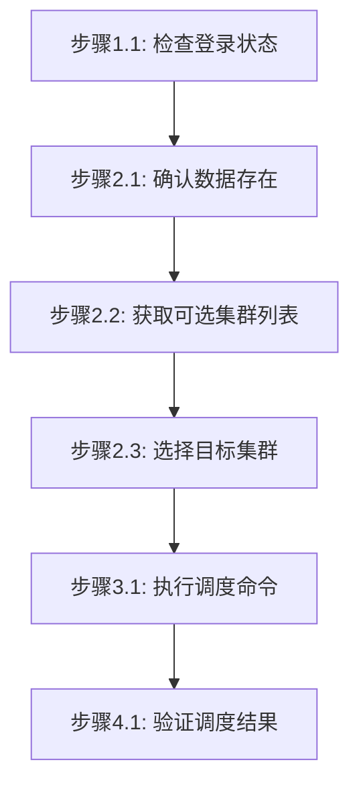

# 数据调度任务步骤

## 概述

本文件定义调度数据到算力中心的执行步骤。数据调度通过数据集、模型或文件包的调度命令实现。

---

## 执行步骤

### 流程图



### 流程说明

- **阶段1-3**（准备工作、确认数据和目标、执行调度）为**线性流程**，按顺序执行
- **阶段4**（验证调度结果）为**非线性流程**，用户可根据需要独立调用，**除非用户明确提及，否则不自动触发**

### 阶段1：准备工作

#### 步骤1.1：检查登录状态

```bash
$login = jcc login --username <username> --password <password> | ConvertFrom-Json
$env:JCC_TOKEN = $login.token
$env:JCC_USER_ID = $login.userID
```

### 阶段2：确认数据和目标

#### 步骤2.1：确认数据存在

根据数据类型查询：

```bash
# 查询数据集
jcc dataset query --output text

# 查询模型
jcc model query --output text

# 查询文件包
jcc commonfile query --output text
```

**输出示例**:
```
PACKAGE ID      NAME              STATUS     SIZE
-----------     ----              ------     ----
dataset-001     training-data     ready      1.2GB
```

#### 步骤2.2：获取可选集群列表

通过查询已有资源或平台接口，获取可选集群列表：

```bash
# 查询已有资源，了解可用集群
jcc dataset query --output text
jcc model query --output text
jcc commonfile query --output text

# 或调用平台集群查询能力
jcc cluster query --output text
```

**说明**: 从返回结果中提取集群名称列表，作为后续选择依据。

#### 步骤2.3：选择目标集群

基于返回的集群列表选择目标集群，并记录集群名称：

```bash
$selectedCluster = "<cluster-name>"
```

**说明**: `<cluster-name>` 为从上述列表中选择的实际集群名称。

### 阶段3：执行调度

#### 步骤3.1：调度数据集

```bash
jcc dataset schedule \
  --cluster-name <cluster-name> \
  [--package-name <dataset-name>]
```

**参数说明**:
- `--cluster-name`: 目标集群名称（必填）
- `--package-name`: 数据集名称（可选）

**示例**:
```bash
jcc dataset schedule --cluster-name ai-cluster-01 --package-name training-data
```

#### 步骤3.2：调度模型

```bash
jcc model schedule \
  --cluster-name <cluster-name> \
  [--package-name <model-name>]
```

**示例**:
```bash
jcc model schedule --cluster-name ai-cluster-01 --package-name llama2-7b
```

#### 步骤3.3：调度文件包

```bash
jcc commonfile schedule \
  --cluster-name <cluster-name> \
  [--package-name <package-name>]
```

**示例**:
```bash
jcc commonfile schedule --cluster-name HPCSlurmArm --package-name my-files
```

### 阶段4：验证调度结果

#### 步骤4.1：验证数据到达

```bash
# 查询数据集状态
jcc dataset query --package-name <dataset-name>

# 查询模型状态
jcc model query --package-name <model-name>

# 查询文件包状态
jcc commonfile query --package-name <package-name>
```

**状态说明**:
| 状态 | 说明 |
|------|------|
| `uploading` | 上传中 |
| `ready` | 准备就绪 |
| `scheduling` | 调度中 |
| `synced` | 已同步到目标集群 |

---

## 执行示例

```bash
# 登录
$login = jcc login --username admin --password mypass123 | ConvertFrom-Json
$env:JCC_TOKEN = $login.token
$env:JCC_USER_ID = $login.userID

# 查询数据集
jcc dataset query --output text

# 调度数据集到目标集群
jcc dataset schedule --cluster-name ai-cluster-01 --package-name training-data

# 验证调度结果
jcc dataset query --package-name training-data
```
