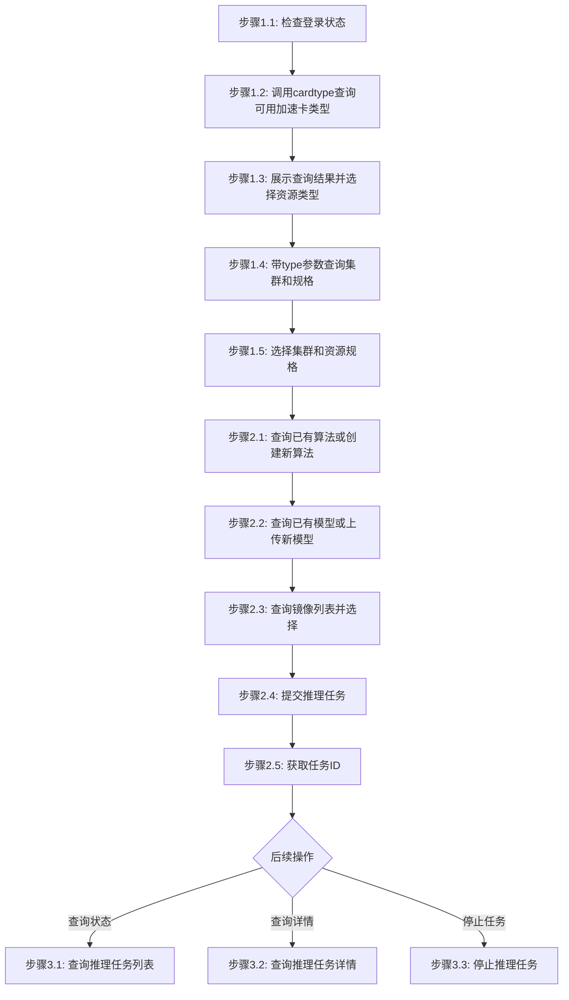

# AI模型推理工作流

## 概述

本工作流实现：上传输入数据 -> 创建数据集 -> 提交智算推理任务 -> 监控推理进度 -> 获取推理结果

## 流程图



### 流程说明

- **阶段1-2**（准备工作、资源选择、任务提交）为**线性流程**，按顺序执行
- **阶段3**（查询列表、查询详情、停止任务）为**非线性流程**，用户可根据需要独立调用，**除非用户明确提及，否则不自动触发**

## 工作流步骤

### 阶段1：准备工作

#### 步骤1.1：检查登录状态

```bash
# 尝试执行一个轻量命令验证登录状态
jcc aiinfer query --output text
```

如果未登录，执行登录：
```bash
$login = jcc login --username <username> --password <password> | ConvertFrom-Json
$env:JCC_TOKEN = $login.token
$env:JCC_USER_ID = $login.userID
$env:JCC_BASE_URL = "https://jcc.jointcloud.net"
```

#### 步骤1.2：查询可用加速卡类型

调用 `cardtype` 接口获取当前用户可用的所有加速卡类型及资源配额：

```bash
jcc aiinfer cardtype --output text
```

从返回结果中提取所有可用的加速卡类型（如 TYPE 列中的 GPU、NPU 等），展示给用户并引导选择。

#### 步骤1.3：根据选定资源类型查询集群和资源规格

根据用户选定的资源类型，带 `--type` 参数调用查询接口获取该类型下的集群和资源规格列表：

```bash
jcc aiinfer cluster-list --type <资源类型> --output text
```

**输出示例**:
```
ID              Name              Status    ResourceType
-----           ----              ------    ------------
ai-cluster-01   AI-Inference-A     active    GPU
ai-cluster-02   AI-Inference-B     active    NPU
```

#### 步骤1.4：选择集群和资源规格

将查询结果展示给用户，引导用户从返回列表中选择集群和资源规格。

### 阶段2：数据准备

#### 步骤2.1：创建输入数据集

```bash
jcc dataset create \
  --name <dataset-name> \
  --path <local-input-path> \
  --clusters <cluster-id>
```

**参数说明**:
- `--name`: 数据集名称（必填）
- `--path`: 本地输入数据路径（必填）
- `--clusters`: 目标集群ID（可多次）

**示例**:
```bash
jcc dataset create --name inference-input-001 --path ./input/ --clusters ai-cluster-01
```

**输出示例**:
```json
{
  "id": "dataset-123456",
  "name": "inference-input-001",
  "status": "ready",
  "bindingId": "binding-ds-789"
}
```

### 阶段3：提交推理任务

#### 步骤3.1：查询可用模型

```bash
jcc model query --output text
```

**输出示例**:
```
ID              Name              Status    Size
-----           ----              ------    ----
model-001       llama2-7b         ready     13GB
model-002       llama2-13b        ready     26GB
```

#### 步骤3.2：提交推理任务

```bash
jcc aiinfer submit \
  --name <task-name> \
  --cluster-name <cluster-name> \
  --code-name <父算法/子算法> \
  --model-name <model-name> \
  [--image-name <image-name>] \
  [--binding-id <binding-id>] \
  --resource <resource-spec> \
  [--command <run-command>] \
  [--env <key=value>] \
  [--param <key=value>]
```

**参数说明**:
- `--name`: 任务名称（必填）
- `--cluster-name`: 目标集群名称（必填）
- `--code-name`: 代码名称，格式为 父算法/子算法（必填）
- `--model-name`: 模型名称（必填）
- `--image-name`: 镜像名称（可选）
- `--binding-id`: 推理服务绑定ID（可选）
- `--resource`: 资源规格，格式: TYPE:TYPE:NUMBER*NAME(显存:XXGiB),CPU:N,内存:NGiB:1（必填，可多次）
- `--command`: 运行命令（可选）
- `--env`: 环境变量 KEY=VALUE（可选，可多次）
- `--param`: 运行参数 KEY=VALUE（可选，可多次）

**示例**:
```bash
jcc aiinfer submit \
  --name molecule-energy-prediction \
  --cluster-name ai-cluster-01 \
  --code-name inference/mp_e_form_alignnn \
  --model-name llama2-7b \
  --image-name pytorch-2.0-cuda11.7 \
  --resource GPU:GPU:1*A100(显存:40GiB),CPU:8,内存:50GiB:1 \
  --param batch_size=16
```

#### 步骤3.3：获取任务ID

任务提交成功后返回：

```json
{
  "taskId": "inference-1234567890",
  "name": "molecule-energy-prediction",
  "status": "pending"
}
```

### 阶段4：监控和管理

#### 步骤4.1：查询推理任务列表

```bash
jcc aiinfer query --output text
```

**输出示例**:
```
ID              Name                      Status    CreatedAt
-----           ----                      ------    ---------
inference-123   molecule-energy-prediction running   2024-01-15T10:30:00Z
```

#### 步骤4.2：查询推理任务详情

```bash
jcc aiinfer detail --task-id <task-id> --output text
```

**详情内容**:
- 任务ID、名称、状态
- 资源配置（GPU、CPU、内存）
- 创建时间、启动时间
- 推理进度

#### 步骤4.3：停止推理任务

```bash
jcc aiinfer stop --task-id <task-id>
```

**适用场景**:
- 推理任务已完成
- 任务出现异常需要终止
- 需要释放资源

## 工作流参数

| 参数名 | 类型 | 必填 | 说明 | 默认值 |
|--------|------|------|------|--------|
| username | string | 是 | 云际平台用户名 | - |
| password | string | 是 | 云际平台密码 | - |
| dataset_name | string | 是 | 输入数据集名称 | - |
| local_input_path | string | 是 | 本地输入数据路径 | - |
| cluster_name | string | 是 | 目标集群名称 | - |
| task_name | string | 是 | 推理任务名称 | - |
| code_name | string | 是 | 代码名称，格式为 父算法/子算法 | - |
| model_name | string | 是 | 模型名称 | - |
| image_name | string | 否 | 镜像名称 | - |
| binding_id | string | 否 | 推理服务绑定ID | - |
| gpu_type | string | 是 | GPU类型 | A100 |
| gpu_count | integer | 是 | GPU数量 | 1 |

## 执行示例

```bash
# === 第1步：登录 ===
$login = jcc login --username admin --password mypass123 | ConvertFrom-Json
$env:JCC_TOKEN = $login.token
$env:JCC_USER_ID = $login.userID

# === 第2步：查询可用加速卡类型 ===
jcc aiinfer cardtype --output text

# === 第3步：根据选定类型查询集群和规格 ===
jcc aiinfer cluster-list --type GPU --output text

# === 第4步：查询可用模型 ===
jcc model query --output text

# === 第5步：提交推理任务 ===
jcc aiinfer submit \
  --name molecule-energy-prediction \
  --cluster-name ai-cluster-01 \
  --code-name llama2/finetune \
  --model-name llama2-7b \
  --image-name pytorch-2.0-cuda11.7 \
  --binding-id binding-inference-456 \
  --resource GPU:GPU:1*A100(显存:40GiB),CPU:8,内存:50GiB:1

# === 第6步：查询推理任务列表 ===
jcc aiinfer query --output text

# === 第7步：查询推理任务详情 ===
jcc aiinfer detail --task-id inference-123 --output text

# === 第8步：停止推理任务（如需） ===
jcc aiinfer stop --task-id inference-123
```
