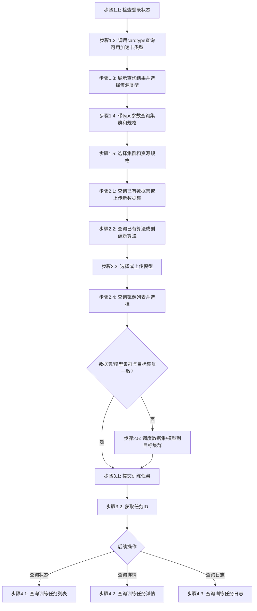

# AI模型训练工作流

## 概述

本工作流实现：上传训练数据 -> 创建数据集 -> 提交智算训练任务 -> 监控训练进度 -> 获取训练结果

## 流程图



### 流程说明

- **阶段1-3**（准备工作、资源选择、提交训练任务）为**线性流程**，按顺序执行
- **阶段4**（查询列表、查询详情、查询日志、查询结果）为**非线性流程**，用户可根据需要独立调用，**除非用户明确提及，否则不自动触发**

## 工作流步骤

### 阶段1：准备工作

#### 步骤1.1：检查登录状态

```bash
# 尝试执行一个轻量命令验证登录状态
jcc aitrain query --output text
```

如果未登录，执行登录：
```bash
$login = jcc login --username <username> --password <password> | ConvertFrom-Json
$env:JCC_TOKEN = $login.token
$env:JCC_USER_ID = $login.userID
$env:JCC_BASE_URL = "https://jcc.jointcloud.net"
```

#### 步骤1.2：查询可用加速卡类型

调用 `cardtype` 接口获取当前用户可用的所有加速卡类型及资源配额：

```bash
jcc aitrain cardtype --output text
```

从返回结果中提取所有可用的加速卡类型（如 TYPE 列中的 GPU、NPU、MLU 等），展示给用户并引导选择。

#### 步骤1.3：根据选定资源类型查询集群和资源规格

根据用户选定的资源类型，带 `--type` 参数调用查询接口获取该类型下的集群和资源规格列表：

```bash
jcc aitrain cluster-list --type <资源类型> --output text
```

**输出示例**:
```
ID              Name              Status    ResourceType
-----           ----              ------    ------------
ai-cluster-01   AI-Training-A     active    GPU
ai-cluster-02   AI-Training-B     active    MLU
```

#### 步骤1.4：选择集群和资源规格

将查询结果展示给用户，引导用户从返回列表中选择集群和资源规格。

### 阶段2：数据准备

#### 步骤2.1：创建数据集

```bash
jcc dataset create \
  --name <dataset-name> \
  --path <local-data-path> \
  --clusters <cluster-id>
```

**参数说明**:
- `--name`: 数据集名称（必填）
- `--path`: 本地数据路径（必填）
- `--clusters`: 目标集群ID（可多次）

**示例**:
```bash
jcc dataset create --name training-data-001 --path ./dataset/ --clusters ai-cluster-01
```

**输出示例**:
```json
{
  "id": "dataset-123456",
  "name": "training-data-001",
  "status": "ready",
  "bindingId": "binding-ds-789"
}
```

#### 步骤2.2：创建模型包（可选）

如果需要预训练模型：

```bash
jcc model create \
  --name <model-name> \
  --path <local-model-path> \
  --clusters <cluster-id>
```

**参数说明**:
- `--name`: 模型名称（必填）
- `--path`: 本地模型路径（必填）
- `--clusters`: 目标集群ID（可多次）

**示例**:
```bash
jcc model create --name base-model-llama2 --path ./model/ --clusters ai-cluster-01
```

#### 步骤2.5：检查数据集/模型集群一致性并调度

在提交训练任务前，检查数据集和模型所在的集群是否与训练任务的目标集群一致。如果不一致，需要先调度到目标集群。

**检查方式**:

从数据集和模型的查询结果中获取其所在集群，与步骤1.5选定的训练目标集群进行对比。

**调度数据集**:

```bash
jcc dataset schedule --cluster-name <目标集群名称> --package-name <数据集名称>
```

**调度模型**（如果使用了模型）:

```bash
jcc model schedule --cluster-name <目标集群名称> --package-name <模型名称>
```

> **注意**: 调度是异步操作，需等待状态变为 `synced` 或 `ready` 后才能提交训练任务。

### 阶段3：提交训练任务

#### 步骤3.1：查询可用集群

```bash
jcc aitrain cluster-list --type <resource-type> --output text
```

**参数说明**:
- `--type`: 资源类型（如 GPU、MLU、NPU）

**输出示例**:
```
ID              Name              Status    ResourceType
-----           ----              ------    ------------
ai-cluster-01   AI-Training-A     active    GPU
ai-cluster-02   AI-Training-B     active    MLU
```

#### 步骤3.2：提交训练任务

```bash
jcc aitrain submit \
  --name <task-name> \
  --cluster-name <cluster-name> \
  --code-name <父算法/子算法> \
  --dataset-name <dataset-name> \
  --model-binding-id <model-binding-id> \
  --image-name <image-name> \
  --resource <resource-spec> \
  [--command <run-command>] \
  [--env <key=value>] \
  [--param <key=value>]
```

**参数说明**:
- `--name`: 任务名称（必填）
- `--cluster-name`: 目标集群名称（必填）
- `--code-name`: 代码名称，格式为 父算法/子算法（必填）
- `--dataset-name`: 数据集名称（必填）
- `--model-binding-id`: 模型绑定ID（必填）
- `--image-name`: 镜像名称（必填）
- `--resource`: 资源规格，格式: TYPE:TYPE:NUMBER*NAME(显存:XXGiB),CPU:N,内存:NGiB:1（必填，可多次）
- `--command`: 运行命令（可选）
- `--env`: 环境变量 KEY=VALUE（可选，可多次）
- `--param`: 运行参数 KEY=VALUE（可选，可多次）

**示例**:
```bash
jcc aitrain submit \
  --name llama2-finetune-001 \
  --cluster-name ai-cluster-01 \
  --code-name llama2/finetune \
  --dataset-name training-data-001 \
  --model-name base-model-llama2 \
  --image-name pytorch-2.0-cuda11.7 \
  --resource GPU:GPU:1*A100(显存:40GiB),CPU:8,内存:50GiB:1 \
  --env CUDA_VISIBLE_DEVICES=0,1,2,3,4,5,6,7 \
  --param learning_rate=1e-5 \
  --param batch_size=32
```

#### 步骤3.3：获取任务ID

任务提交成功后返回：

```json
{
  "taskId": "train-1234567890",
  "name": "llama2-finetune-001",
  "status": "pending"
}
```

### 阶段4：监控和获取结果

#### 步骤4.1：查询训练任务列表

```bash
jcc aitrain query --output text
```

**输出示例**:
```
ID              Name                  Status    CreatedAt
-----           ----                  ------    ---------
train-123456    llama2-finetune-001   running   2024-01-15T10:30:00Z
```

#### 步骤4.2：查询训练任务详情

```bash
jcc aitrain detail --task-id <task-id> --output text
```

**详情内容**:
- 任务ID、名称、状态
- 资源配置（GPU、CPU、内存）
- 创建时间、启动时间、预计完成时间
- 训练进度（Epoch、Step）

#### 步骤4.3：查询训练任务日志

```bash
jcc aitrain log --task-id <task-id>
```

**日志内容**:
- 任务启动信息
- 训练过程输出
- 损失值变化
- 验证准确率
- 警告和错误信息

## 工作流参数

| 参数名 | 类型 | 必填 | 说明 | 默认值 |
|--------|------|------|------|--------|
| username | string | 是 | 云际平台用户名 | - |
| password | string | 是 | 云际平台密码 | - |
| dataset_name | string | 是 | 数据集名称 | - |
| local_data_path | string | 是 | 本地训练数据路径 | - |
| model_name | string | 否 | 模型名称 | - |
| local_model_path | string | 否 | 本地模型路径 | - |
| cluster_name | string | 是 | 目标集群名称 | - |
| task_name | string | 是 | 训练任务名称 | - |
| code_name | string | 是 | 代码名称，格式为 父算法/子算法 | - |
| image_id | string | 是 | 镜像ID | - |
| gpu_type | string | 是 | GPU类型 | A100 |
| gpu_count | integer | 是 | GPU数量 | 8 |
| cpu_count | integer | 否 | CPU数量 | 32 |

## 执行示例

```bash
# === 第1步：登录 ===
$login = jcc login --username admin --password mypass123 | ConvertFrom-Json
$env:JCC_TOKEN = $login.token
$env:JCC_USER_ID = $login.userID

# === 第2步：创建数据集 ===
jcc dataset create --name training-data-001 --path ./dataset/ --clusters ai-cluster-01

# === 第3步：创建模型包（可选） ===
jcc model create --name base-model-llama2 --path ./model/ --clusters ai-cluster-01

# === 第4步：查询可用加速卡类型 ===
jcc aitrain cardtype --output text

# === 第5步：根据选定类型查询集群和规格 ===
jcc aitrain cluster-list --type GPU --output text

# === 第6步：检查数据集/模型集群一致性，不一致则调度 ===
# 若数据集/模型所在集群与训练目标集群不一致，执行调度
jcc dataset schedule --cluster-name <目标集群名称> --package-name <数据集名称>
jcc model schedule --cluster-name <目标集群名称> --package-name <模型名称>

# === 第7步：提交训练任务 ===
jcc aitrain submit \
  --name llama2-finetune-001 \
  --cluster-name ai-cluster-01 \
  --code-name llama2/finetune \
  --dataset-name training-data-001 \
  --model-binding-id binding-model-123 \
  --image-name pytorch-2.0-cuda11.7 \
  --resource GPU:GPU:1*A100(显存:40GiB),CPU:8,内存:50GiB:1

# === 第8步：查询训练任务列表 ===
jcc aitrain query --output text

# === 第9步：查询训练任务详情 ===
jcc aitrain detail --task-id train-123456 --output text

# === 第10步：查询训练任务日志 ===
jcc aitrain log --task-id train-123456
