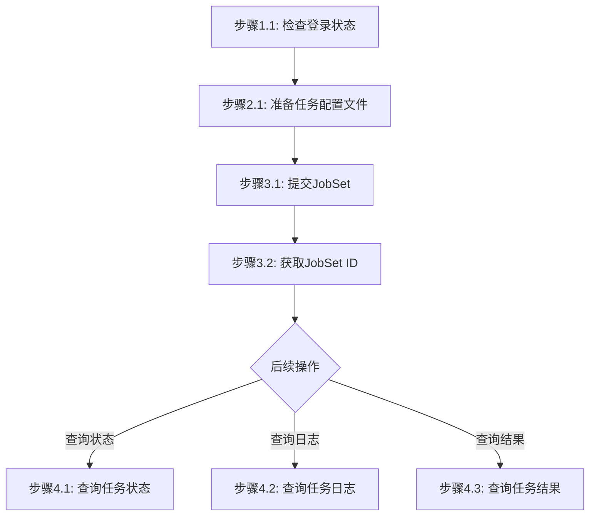

# 批量任务处理工作流

## 概述

本工作流实现：准备任务列表 -> 提交JobSet工作流 -> 监控执行状态 -> 获取执行结果

## 流程图



### 流程说明

- **阶段1-3**（准备工作、准备配置文件、提交JobSet）为**线性流程**，按顺序执行
- **阶段4**（查询状态、查询日志、查询结果）为**非线性流程**，用户可根据需要独立调用，**除非用户明确提及，否则不自动触发**

## 工作流步骤

### 阶段1：准备工作

#### 步骤1.1：检查登录状态

```bash
jcc login --help
```

如果未登录，执行登录：
```bash
$login = jcc login --username <username> --password <password> | ConvertFrom-Json
$env:JCC_TOKEN = $login.token
$env:JCC_USER_ID = $login.userID
```

### 阶段2：准备任务配置文件

#### 步骤2.1：创建任务配置文件

创建JSON格式的JobSet配置文件：

```json
{
  "name": "batch-processing-001",
  "description": "Batch processing task",
  "jobs": [
    {
      "name": "vasp-task-1",
      "type": "hpc",
      "clusterName": "HPCSlurmArm",
      "packageName": "vasp-input-001",
      "appType": "vasp",
      "nodes": 1,
      "ntasks": 4
    },
    {
      "name": "vasp-task-2",
      "type": "hpc",
      "clusterName": "HPCSlurmArm",
      "packageName": "vasp-input-002",
      "appType": "vasp",
      "nodes": 1,
      "ntasks": 4
    }
  ]
}
```

**配置说明**:
- `name`: JobSet名称
- `description`: JobSet描述
- `jobs`: 任务列表
  - `name`: 任务名称
  - `type`: 任务类型（hpc/train/inference）
  - `clusterName`: 目标集群名称
  - `packageName`: 文件包名称（HPC任务）
  - `appType`: 应用类型（HPC任务）
  - `nodes`: 计算节点数量
  - `ntasks`: 每个节点任务数

### 阶段3：提交JobSet

#### 步骤3.1：提交JobSet

```bash
jcc jobset submit --data-file <json-file>
```

**参数说明**:
- `--data-file`: JobSet JSON配置文件路径（必填）

**示例**:
```bash
jcc jobset submit --data-file ./jobset-config.json
```

#### 步骤3.2：获取JobSet ID

提交成功后返回：

```json
{
  "jobSetId": "jobset-1234567890",
  "name": "batch-processing-001",
  "status": "pending"
}
```

### 阶段4：监控和获取结果

#### 步骤4.1：查询任务状态

根据任务类型查询状态：

```bash
# 查询超算任务状态
jcc hpc status --task-name <task-name> --output text

# 查询训练任务列表
jcc aitrain query --output text

# 查询推理任务列表
jcc aiinfer query --output text
```

#### 步骤4.2：查询任务日志

```bash
# 查询超算任务日志
jcc hpc log --task-name <task-name>

# 查询训练任务日志
jcc aitrain log --id <task-id>
```

#### 步骤4.3：查询任务结果

```bash
# 查询超算任务结果
jcc hpc result --task-name <task-name>

# 查询训练任务结果
jcc aitrain result --id <task-id>
```

## 工作流参数

| 参数名 | 类型 | 必填 | 说明 |
|--------|------|------|------|
| username | string | 是 | 云际平台用户名 |
| password | string | 是 | 云际平台密码 |
| data_file | string | 是 | JobSet配置文件路径 |

## 执行示例

```bash
# === 第1步：登录 ===
$login = jcc login --username admin --password mypass123 | ConvertFrom-Json
$env:JCC_TOKEN = $login.token
$env:JCC_USER_ID = $login.userID

# === 第2步：准备JobSet配置文件 ===
# 创建 jobset-config.json 文件

# === 第3步：提交JobSet ===
jcc jobset submit --data-file ./jobset-config.json

# === 第4步：查询任务状态 ===
jcc hpc status --task-name vasp-task-1 --output text

# === 第5步：查询任务日志 ===
jcc hpc log --task-name vasp-task-1

# === 第6步：查询任务结果 ===
jcc hpc result --task-name vasp-task-1
