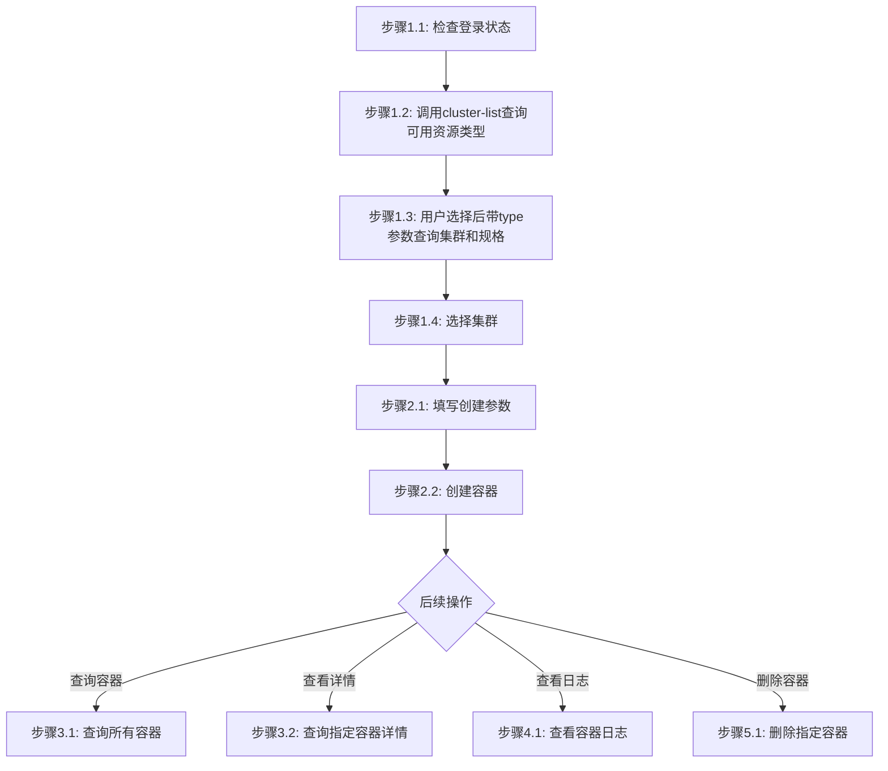

# 容器部署工作流

## 概述

本工作流实现：创建容器 -> 查询容器列表 -> 查看容器详情 -> 查看容器日志 -> 删除容器

## 流程图



### 流程说明

- **阶段1-2**（准备工作、资源类型与规格选择、填写参数并创建容器）为**线性流程**，按顺序执行。只要用户表示需要创建容器，在完成登录和资源选择后，应自动进入填写创建参数和创建容器步骤。
- **阶段3-5**（查询容器、查看日志、删除容器）为**非线性流程**，用户可根据需要独立调用，**除非用户明确提及，否则不自动触发**。

## 工作流步骤

### 阶段1：准备与资源选择

#### 步骤1.1：检查登录状态

```bash
# 尝试执行一个轻量命令验证登录状态
jcc aitrain query --output text
```

如果命令因未授权/缺少 token 失败，则执行登录并设置环境变量：

```bash
$login = jcc login --username <username> --password <password> | ConvertFrom-Json
$env:JCC_TOKEN = $login.token
$env:JCC_USER_ID = $login.userID
$env:JCC_BASE_URL = "https://jcc.jointcloud.net"
```

#### 步骤1.2：查询可用资源类型

调用查询接口获取平台当前支持的所有资源类型：

```bash
jcc cloudcontainer cluster-list --output text
```

从返回结果中提取可用的资源类型（如 TYPE 列），展示给用户并引导选择。

#### 步骤1.3：根据选定资源类型查询集群和规格

根据用户选定的资源类型，带 `--type` 参数再次调用查询接口获取该类型下的集群和资源规格列表：

```bash
jcc cloudcontainer cluster-list --type <资源类型> --output text
```

**参数说明**:
- `--type`: 资源类型（默认 CPU），支持 CPU/GPU

**输出示例**:
```
ID              Name              Status
-----           ----              ------
cluster-001     CPU-Cluster       active
cluster-002     GPU-Cluster       active
```

#### 步骤1.4：选择集群

将查询结果展示给用户，引导用户从返回列表中选择一个集群：

```bash
$selectedCluster = "<用户选择的集群名称>"
```

**说明**: 后续创建命令中的 `--cluster-name` 使用此值。

### 阶段2：创建容器

#### 步骤2.1：填写创建参数

确认以下必填参数已准备就绪。资源规格（CPU/内存）可由步骤1.3查询结果自动带出：

| 参数 | 说明 | 示例 |
|------|------|------|
| name | 容器名称 | myapp |
| image | 镜像 | nginx:latest |
| cpu | CPU资源（可由cluster-list查询结果自动带出） | 100 |
| memory | 内存资源（可由cluster-list查询结果自动带出） | 256 |

可选参数：

| 参数 | 说明 | 默认值 |
|------|------|--------|
| port | 端口 | - |
| replica | 副本数 | 1 |
| command | 启动命令 | - |
| args | 启动参数（可多次） | - |
| env | 环境变量 KEY=VALUE（可多次） | - |
| description | 描述 | - |
| mount-path | 挂载路径 | - |
| node-port | 节点端口 | - |
| container-group | 容器组名称 | 同 name |
| capacity | 容量 | - |

#### 步骤2.2：执行创建命令

```bash
jcc cloudcontainer create \
  --cluster-name <cluster-name> \
  --name <name> \
  --image <image> \
  --cpu <cpu> \
  --memory <memory> \
  [--port <port>] \
  [--replica <replica>] \
  [--command <command>] \
  [--args <arg>] \
  [--env <key=value>] \
  [--description <description>]
```

**示例**:
```bash
jcc cloudcontainer create --cluster-name CPU-Cluster --name myapp --image nginx:latest --cpu 100 --memory 256 --port 8080 --replica 2
```

---

### 阶段3：查询容器

#### 步骤3.1：查询所有容器

```bash
jcc cloudcontainer query --page-num 1 --page-size 10 --output text
```

**可选过滤参数**:

| 参数 | 说明 | 默认值 | 示例 |
|------|------|--------|------|
| `--name` | 任务名称过滤 | - | `--name mycontainer` |
| `--status` | 任务状态过滤 | - | `--status running` |
| `--type` | 任务类型过滤 | - | `--type 1` |
| `--page-num` | 页码 | 1 | `--page-num 1` |
| `--page-size` | 页大小 | 10 | `--page-size 10` |

**输出示例**:
```
ID              Name              Status    CreatedAt
-----           ----              ------    ---------
container-001   nginx-server      running   2024-01-15T10:30:00Z
container-002   redis-cache       running   2024-01-15T11:00:00Z
```

#### 步骤3.2：查询指定容器详情

```bash
jcc cloudcontainer query --id <container-id> --output text
```

**详情内容**:
- 容器ID、名称、状态
- 资源配置（CPU、内存）
- 创建时间、运行时长
- 网络配置

### 阶段4：查看容器日志

#### 步骤4.1：查看容器日志

```bash
jcc cloudcontainer log --name <container-name>
```

> 注意：需要在容器状态变为 Running 后才能查询日志，Pending 状态下会报 deployments.apps "xxx" not found 错误

**日志内容**:
- 容器启动信息
- 应用运行日志
- 标准输出和标准错误
- 警告和错误信息

### 阶段5：删除容器

#### 步骤5.1：删除指定容器

```bash
jcc cloudcontainer delete --name <container-name>
```

**确认删除**:
删除前确认容器名称和ID，删除后无法恢复

## 工作流参数

| 参数名 | 类型 | 必填 | 说明 |
|--------|------|------|------|
| username | string | 是 | 云际平台用户名 |
| password | string | 是 | 云际平台密码 |
| container_name | string | 是 | 容器名称 |

## 执行示例

```bash
# === 第1步：登录 ===
$login = jcc login --username admin --password mypass123 | ConvertFrom-Json
$env:JCC_TOKEN = $login.token
$env:JCC_USER_ID = $login.userID

# === 第2步：查询可用资源类型 ===
jcc cloudcontainer cluster-list --output text

# === 第3步：根据选定资源类型查询集群和规格 ===
jcc cloudcontainer cluster-list --type CPU --output text

# === 第4步：创建容器 ===
jcc cloudcontainer create --cluster-name CPU-Cluster --name nginx-prod --image nginx:latest --cpu 100 --memory 256 --port 80 --replica 1

# === 第5步：查询所有容器 ===
jcc cloudcontainer query --page-num 1 --page-size 10 --output text

# === 第6步：查询指定容器详情 ===
jcc cloudcontainer query --id container-001 --output text

# === 第7步：查看容器日志 ===
jcc cloudcontainer log --name container-001

# === 第8步：删除容器（如需） ===
jcc cloudcontainer delete --name container-001