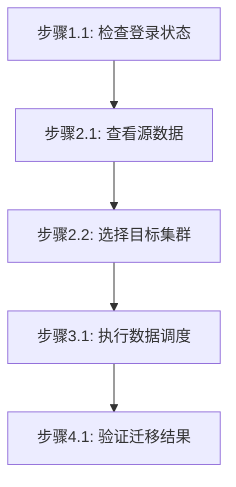

# 跨算力中心数据迁移工作流

## 概述

本工作流实现：查看源数据 -> 选择目标集群 -> 调度数据到目标集群 -> 验证迁移结果

## 流程图



### 流程说明

- **阶段1-3**（准备工作、查看数据、执行调度）为**线性流程**，按顺序执行
- **阶段4**（验证迁移结果）为**非线性流程**，用户可根据需要独立调用，**除非用户明确提及，否则不自动触发**

## 工作流步骤

### 阶段1：准备工作

#### 步骤1.1：检查登录状态

```bash
jcc login --help
```

如果未登录，执行登录：
```bash
$login = jcc login --username <username> --password <password> | ConvertFrom-Json
$env:JCC_TOKEN = $login.token
$env:JCC_USER_ID = $login.userID
```

### 阶段2：查看数据和选择目标

#### 步骤2.1：查看源数据

```bash
# 查询数据集
jcc dataset query --output text

# 查询模型
jcc model query --output text

# 查询文件包
jcc commonfile query --output text
```

**输出示例**:
```
PACKAGE ID      NAME              STATUS    SIZE
-----------     ----              ------    ----
dataset-001     training-data     ready     10GB
dataset-002     inference-data    ready     500MB
```

#### 步骤2.2：选择目标集群

直接指定目标集群名称：
```bash
$targetCluster = "ai-cluster-02"
```

### 阶段3：调度数据到目标集群

#### 步骤3.1：调度数据集

```bash
jcc dataset schedule \
  --cluster-name <cluster-name> \
  [--package-name <dataset-name>]
```

**参数说明**:
- `--cluster-name`: 目标集群名称（必填）
- `--package-name`: 数据集名称（可选）

**示例**:
```bash
jcc dataset schedule --cluster-name ai-cluster-02 --package-name training-data
```

#### 步骤3.2：调度模型（可选）

```bash
jcc model schedule \
  --cluster-name <cluster-name> \
  [--package-name <model-name>]
```

**示例**:
```bash
jcc model schedule --cluster-name ai-cluster-02 --package-name llama2-7b
```

#### 步骤3.3：调度文件包（可选）

```bash
jcc commonfile schedule \
  --cluster-name <cluster-name> \
  [--package-name <package-name>]
```

**示例**:
```bash
jcc commonfile schedule --cluster-name HPCSlurmX86 --package-name my-files
```

### 阶段4：验证迁移结果

#### 步骤4.1：检查目标数据

```bash
# 查询数据集状态
jcc dataset query --package-name <dataset-name>

# 查询模型状态
jcc model query --package-name <model-name>

# 查询文件包状态
jcc commonfile query --package-name <package-name>
```

**状态说明**:
| 状态 | 说明 |
|------|------|
| `uploading` | 上传中 |
| `ready` | 准备就绪 |
| `scheduling` | 调度中 |
| `synced` | 已同步到目标集群 |

## 工作流参数

| 参数名 | 类型 | 必填 | 说明 | 默认值 |
|--------|------|------|------|--------|
| username | string | 是 | 云际平台用户名 | - |
| password | string | 是 | 云际平台密码 | - |
| package_name | string | 是 | 数据/模型/文件包名称 | - |
| cluster_name | string | 是 | 目标集群名称 | - |
| data_type | string | 是 | 数据类型：dataset/model/commonfile | dataset |

## 执行示例

```bash
# === 第1步：登录 ===
$login = jcc login --username admin --password mypass123 | ConvertFrom-Json
$env:JCC_TOKEN = $login.token
$env:JCC_USER_ID = $login.userID

# === 第2步：查看源数据 ===
jcc dataset query --output text

# === 第3步：执行数据调度 ===
jcc dataset schedule --cluster-name ai-cluster-02 --package-name training-data

# === 第4步：验证数据到达 ===
jcc dataset query --package-name training-data
```
