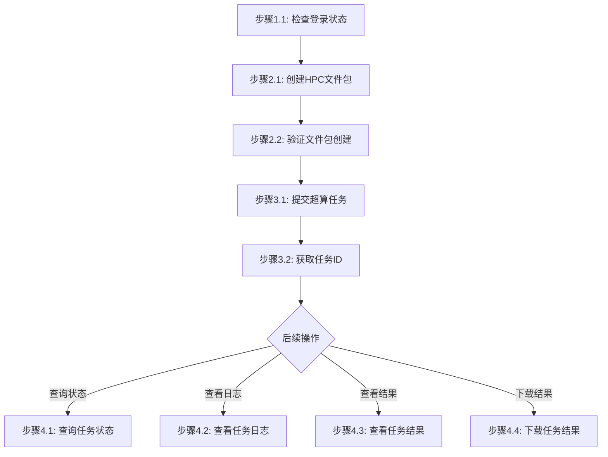

# 数据处理工作流

## 概述

本工作流实现：上传数据 -> 创建文件包 -> 提交超算任务 -> 监控任务进度 -> 下载结果

## 流程图



### 流程说明

- **阶段1-3**（准备工作、创建文件包、提交超算任务）为**线性流程**，按顺序执行
- **阶段4**（查询状态、查看日志、查看结果、下载结果）为**非线性流程**，用户可根据需要独立调用，**除非用户明确提及，否则不自动触发**

## 工作流步骤

### 阶段1：准备工作

#### 步骤1.1：检查登录状态

```bash
jcc login --help
```

如果未登录，执行登录：
```bash
$login = jcc login --username <username> --password <password> | ConvertFrom-Json
$env:JCC_TOKEN = $login.token
$env:JCC_USER_ID = $login.userID
```

### 阶段2：创建HPC文件包

#### 步骤2.1：创建文件包

```bash
jcc commonfile create \
  --name <package-name> \
  --path <local-files-path> \
  --cluster-name <cluster-name>
```

**参数说明**:
- `--name`: 文件包名称（必填）
- `--path`: 本地文件路径（必填）
- `--cluster-name`: 目标集群名称（必填）

**示例**:
```bash
jcc commonfile create --name vasp-input-001 --path ./vasp-files/ --cluster-name HPCSlurmArm
```

**输出示例**:
```json
{
  "id": "package-123456",
  "name": "vasp-input-001",
  "status": "ready",
  "clusterName": "HPCSlurmArm"
}
```

#### 步骤2.2：验证文件包创建

```bash
jcc commonfile query --id <package-id> --output text
```

### 阶段3：提交超算任务

#### 步骤3.1：提交超算任务

```bash
jcc hpc create \
  --name <task-name> \
  --cluster-name <cluster-name> \
  --package-name <package-name> \
  --apptype <application-type> \
  [--nodes <number>] \
  [--ntasks <number>]
```

**参数说明**:
- `--name`: 任务名称（必填）
- `--cluster-name`: 目标集群名称（必填）
- `--package-name`: 已有包名称（必填）
- `--apptype`: 应用类型（必填），如 vasp、cfd 等
- `--nodes`: 计算节点数量（可选，默认1）
- `--ntasks`: 每个节点任务数（可选，默认4）

**示例**:
```bash
jcc hpc create --name vasp-calculation-001 --cluster-name HPCSlurmArm --package-name vasp-input-001 --apptype vasp --nodes 2 --ntasks 8
```

#### 步骤3.2：获取任务ID

任务提交成功后返回：

```json
{
  "taskId": "hpc-1234567890",
  "name": "vasp-calculation-001",
  "status": "pending"
}
```

### 阶段4：监控和获取结果

#### 步骤4.1：查询任务状态

```bash
jcc hpc status --task-name <task-name> --output text
```

**状态说明**:
| 状态 | 说明 |
|------|------|
| `pending` | 等待调度 |
| `running` | 运行中 |
| `completed` | 已完成 |
| `failed` | 失败 |
| `cancelled` | 已取消 |

#### 步骤4.2：查看任务日志

```bash
jcc hpc log --task-name <task-name>
```

**日志内容**:
- 任务启动时间
- 执行进度
- 标准输出和标准错误
- 警告和错误信息

#### 步骤4.3：查看任务结果

```bash
jcc hpc result --task-name <task-name>
```

**结果内容**:
- 输出文件列表
- 文件大小
- 创建时间

#### 步骤4.4：下载任务结果

```bash
jcc hpc result download --task-name <task-name> [--output <path>]
```

**参数说明**:
- `--task-name`: 任务名称（必填）
- `--output`: 输出文件路径（可选，默认为 `<task-name>.zip`）

**示例**:
```bash
jcc hpc result download --task-name vasp-calculation-001 --output ./result.zip
```

## 工作流参数

| 参数名 | 类型 | 必填 | 说明 | 默认值 |
|--------|------|------|------|--------|
| username | string | 是 | 云际平台用户名 | - |
| password | string | 是 | 云际平台密码 | - |
| package_name | string | 是 | 文件包名称 | - |
| local_files_path | string | 是 | 本地文件路径 | - |
| cluster_name | string | 是 | 目标集群名称 | HPCSlurmArm |
| task_name | string | 是 | 超算任务名称 | - |
| apptype | string | 是 | 应用类型 | vasp |
| nodes | integer | 否 | 计算节点数量 | 1 |
| ntasks | integer | 否 | 每个节点任务数 | 4 |

## 执行示例

```bash
# === 第1步：登录 ===
$login = jcc login --username admin --password mypass123 | ConvertFrom-Json
$env:JCC_TOKEN = $login.token
$env:JCC_USER_ID = $login.userID

# === 第2步：创建HPC文件包 ===
jcc commonfile create --name vasp-input-001 --path ./vasp-files/ --cluster-name HPCSlurmArm

# === 第3步：提交超算任务 ===
jcc hpc create --name vasp-calculation-001 --cluster-name HPCSlurmArm --package-name vasp-input-001 --apptype vasp --nodes 2 --ntasks 8

# === 第4步：查询任务状态 ===
jcc hpc status --task-name vasp-calculation-001 --output text

# === 第5步：查看任务日志 ===
jcc hpc log --task-name vasp-calculation-001

# === 第6步：查看任务结果 ===
jcc hpc result --task-name vasp-calculation-001

# === 第7步：下载任务结果 ===
jcc hpc result download --task-name vasp-calculation-001 --output ./result.zip
```
