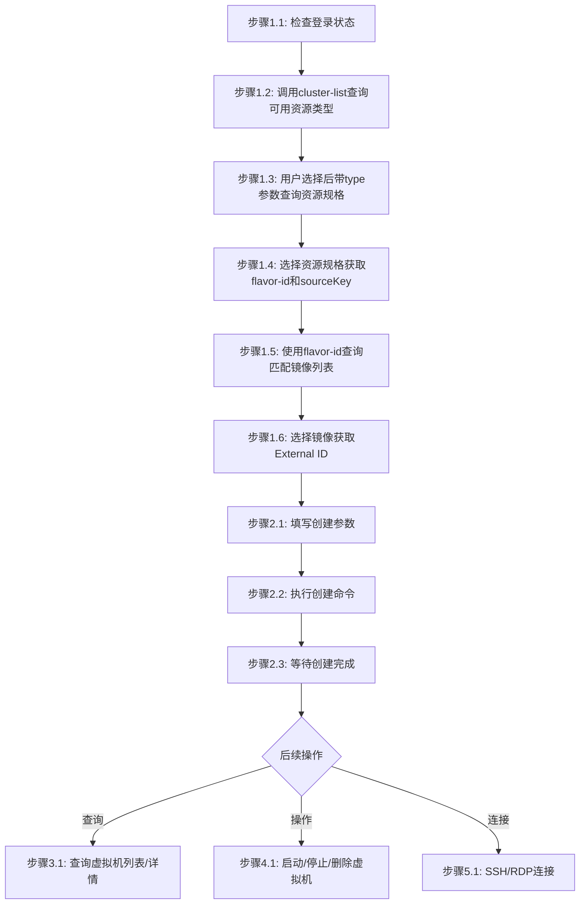

# 云算虚拟机部署工作流

## 概述

本工作流实现：选择资源类型 -> 查询资源规格 -> 查询镜像 -> 创建云算虚拟机 -> 查看虚拟机信息 -> 管理虚拟机生命周期

**适用范围**：通过云际平台 API 创建和管理云算虚拟机实例。

---

## 流程图



### 流程说明

- **阶段1-2**（准备工作、资源类型与规格选择、获取flavor-id、查询并选择镜像、填写参数并创建虚拟机实例）为**线性流程**，按顺序执行。只要用户表示需要创建虚拟机实例，在完成登录和资源选择后，应自动进入获取flavor-id、查询镜像、填写创建参数和创建虚拟机实例步骤。
- **阶段3-6**（查询、生命周期操作、远程连接、删除）为**非线性流程**，用户可根据需要独立调用，**除非用户明确提及，否则不自动触发**。

---

## 工作流步骤

### 阶段1：准备与资源选择

#### 步骤1.1：检查登录状态

```bash
# 尝试执行一个轻量命令验证登录状态
jcc aitrain query --output text
```

如果命令因未授权/缺少 token 失败，则执行登录并设置环境变量：

```bash
$login = jcc login --username <username> --password <password> | ConvertFrom-Json
$env:JCC_TOKEN = $login.token
$env:JCC_USER_ID = $login.userID
$env:JCC_BASE_URL = "https://jcc.jointcloud.net"
```

#### 步骤1.2：查询可用资源类型

调用查询接口获取平台当前支持的所有资源类型：

```bash
jcc cloudinstance cluster-list --output text
```

从返回结果中提取可用的资源类型（如 TYPE 列），展示给用户并引导选择。

#### 步骤1.3：根据选定资源类型查询资源规格列表

根据用户选定的资源类型，带 `--type` 参数再次调用查询接口获取该类型下的资源规格列表（规格 ID/名称 + 集群信息）：

```bash
jcc cloudinstance cluster-list --type <资源类型> --output text
```

**参数说明**:
- `--type`: 资源类型（可选，默认 CPU），支持 CPU/GPU

**输出示例**:
```
ID        NAME             TYPE  CPU    MEMORY  AVAIL  REGION          SOURCE KEY         CLUSTER NAME
14447504  CPU:1,内存:2GiB    CPU   1core  2gb     1/1    default         ecs.c1m2           电信私有云
14447503  CPU:1,内存:1GiB    CPU   1core  1gb     1/1    default         ecs.c1m1           电信私有云
341       CPU:1,内存:0.5GiB  CPU   1core  0.5gb   1/1    cn-zhangjiakou  ecs.t5-lc2m1.nano  阿里云
14447506  CPU:4,内存:8GiB    CPU   4core  8gb     1/1    default         ecs.c4m8           电信私有云
14447505  CPU:2,内存:4GiB    CPU   2core  4gb     1/1    default         ecs.c2m4           电信私有云
```
其中 `SOURCE KEY` 为底层云平台对应的实例规格标识（如阿里云的 `ecs.t5-lc2m1.nano`、电信私有云的 `ecs.c1m1` 等）。

#### 步骤1.4：选择资源规格并获取 flavor-id

将查询结果展示给用户，引导用户从返回列表中选择一个资源规格，记录其 **ID**（flavor-id）、**SOURCE KEY**（sourceKey）和 **CLUSTER NAME**（集群名称）：

```bash
$flavorId = "<ID列值>"
$sourceKey = "<SOURCE KEY列值>"
$selectedCluster = "<CLUSTER NAME列值>"
```

**说明**: 
- `flavor-id`（列表中的ID列）用于后续查询匹配的镜像
- `sourceKey`（列表中的SOURCE KEY列）用于创建命令的 `--instance-type` 参数
- `--cluster-name` 使用选中的集群名称

#### 步骤1.5：使用 flavor-id 查询匹配的镜像列表

使用步骤1.4获取的 flavor-id，调用查询接口获取与该资源规格匹配的镜像列表：

```bash
jcc image list --flavor-id <flavor-id> --output text
```

**参数说明**:
- `--flavor-id`: 资源规格ID（必填，来自步骤1.4）
- `--page`: 分页页码（默认1）
- `--size`: 每页数量（默认10）

**输出示例**:
```
total: 3  page: 1  size: 10

=== 镜像列表 ===
ID   External ID                                     Name                                                  Tag  Kind  Provider  Status     Description                                     Created
658  ubuntu_20_04_uefi_x64_20G_alibase_20220324.vhd  ubuntu_20_04_uefi_x64_20G_alibase_20220324.vhd       vm    阿里云       available                                                  2026-02-06 02:22:23
654  ubuntu_18_04_uefi_x64_20G_alibase_20220330.vhd  ubuntu_18_04_uefi_x64_20G_alibase_20220330.vhd       vm    阿里云       available                                                  2026-02-06 02:22:23
297  ubuntu_20_04_x64_20G_alibase_20251031.vhd       ubuntu_20_04_x64_20G_alibase_20251031.vhd            vm    阿里云       available  Kernel version is 5.4.0-216-generic, 2025.11.3  2026-02-06 02:22:23
```
其中 `External ID` 为底层云平台的镜像标识（如阿里云镜像文件名），`Name` 为平台可见的镜像名称。

#### 步骤1.6：选择镜像

将镜像列表展示给用户，引导用户选择镜像，记录其 **External ID**：

```bash
$externalImageId = "<External ID列值>"
```

**说明**: 后续创建命令中的 `--image-id` 使用此值（External ID，非 ID 列值）。

---

### 阶段2：创建云算虚拟机实例

#### 步骤2.1：准备创建参数

确认以下必填参数已准备就绪：

**必填参数**:

| 参数 | 说明 | 示例 | 来源 |
|------|------|------|------|
| cluster_name | 目标集群名称 | 阿里云 | 步骤1.4 |
| host_name | 主机名（主机名必须唯一，重复会导致创建失败，建议使用随机名称） | node-1 | 用户输入 |
| instance_type | 虚拟机实例类型（即sourceKey） | ecs.t5-lc2m1.nano | 步骤1.4 |
| password | 登录密码 | MyPass123 | 用户输入 |
| image_id | 镜像标识（即External ID） | ubuntu_20_04_x64_20G_alibase_20251031.vhd | 步骤1.6 |
| system_disk_size | 系统盘大小(GB) | 20 | 用户输入 |

**可选参数**:

| 参数 | 说明 | 默认值 |
|------|------|--------|
| username | 用户名 | root |
| charge_type | 计费类型 | PostPaid |
| disk_category | 系统盘类型 | cloud_ssd |
| disk_level | 性能级别 | PL0 |
| replica | 副本数 | 1 |
| security_group_id | 安全组ID | - |

#### 步骤2.2：执行创建命令

```bash
jcc cloudinstance create \
  --cluster-name <cluster-name> \
  --host-name <host-name> \
  --instance-type <sourceKey> \
  --password <password> \
  --image-id <externalImageId> \
  --system-disk-size <size> \
  [--username <username>] \
  [--charge-type <charge-type>] \
  [--disk-category <disk-category>] \
  [--disk-level <disk-level>] \
  [--replica <replica>] \
  [--security-group-id <security-group-id>]
```

**示例**:
```bash
jcc cloudinstance create --cluster-name "阿里云" --host-name node-1 --instance-type ecs.t5-lc2m1.nano --password MyPass123 --image-id ubuntu_20_04_x64_20G_alibase_20251031.vhd --system-disk-size 20 --username root --charge-type PostPaid --disk-category cloud_ssd --disk-level PL0 --replica 1
```

---

### 阶段3：查询和管理虚拟机

#### 步骤3.1：查询所有虚拟机

```bash
jcc cloudinstance query --output text
```

**输出示例**：
```
ID              HostName         Status    CPU     Memory    PublicIP
-----           --------         ------    ---     ------    ---------
instance-001    vm-node-01       running   1核     0.5GB     203.0.113.50
instance-002    vm-node-02       stopped   2核     4GB       203.0.113.51
```

#### 步骤3.2：查询指定虚拟机详情

```bash
jcc cloudinstance query --host-name <host-name> --output text
```

**详情内容**：
- 虚拟机实例ID、主机名、状态
- IP地址（公网/私网）
- 资源配置（CPU、内存、磁盘、GPU）
- 创建时间、运行时长

---

### 阶段4：操作虚拟机生命周期

#### 步骤4.1：启动虚拟机

```bash
jcc cloudinstance operate --host-name <host-name> --operate-type start
```

#### 步骤4.2：停止虚拟机

```bash
jcc cloudinstance operate --host-name <host-name> --operate-type stop
```

#### 步骤4.3：验证操作结果

```bash
jcc cloudinstance query --host-name <host-name> --output text
```

**状态检查**：
| 状态 | 说明 |
|------|------|
| `pending` | 等待启动 |
| `running` | 运行中 |
| `stopping` | 正在停止 |
| `stopped` | 已停止 |

---

### 阶段5：远程连接和配置（可选）

#### 步骤5.1：获取连接信息

```bash
# 获取虚拟机实例详情
jcc cloudinstance query --host-name <host-name> --output text
```

记录公网IP和认证信息。

#### 步骤5.2：SSH 连接（Linux）

```bash
ssh username@<public-ip>
```

#### 步骤5.3：远程桌面连接（Windows）

使用 RDP 客户端连接公网 IP。

#### 步骤5.4：上传文件

```bash
# Linux/Mac
scp -r ./local-path/* username@<public-ip>:/remote-path/

# Windows PowerShell
scp -r ./local-path/* username@<public-ip>:/remote-path/
```

---

### 阶段6：删除虚拟机（如需）

使用以下命令删除虚拟机实例：

```bash
jcc cloudinstance operate --host-name <host-name> --operate-type delete
```

---

## 工作流参数

### 输入参数

| 参数名 | 类型 | 必填 | 说明 |
|--------|------|------|------|
| username | string | 是 | 云际平台用户名 |
| password | string | 是 | 云际平台密码 |
| cluster_name | string | 是（创建时） | 目标集群名称（来自cloudinstance cluster-list查询结果的CLUSTER NAME列） |
| host_name | string | 是（创建/操作时） | 主机名（主机名必须唯一，重复会导致创建失败） |
| instance_type | string | 是（创建时） | 虚拟机实例类型（即sourceKey，来自cloudinstance cluster-list查询结果的SOURCE KEY列） |
| image_id | string | 是（创建时） | 镜像标识（即External ID，来自image list查询结果的External ID列） |
| security_group_id | string | 否（创建时） | 安全组ID |
| system_disk_size | string | 是（创建时） | 系统盘大小 |
| operate_type | string | 是（操作时） | 操作类型：start/stop/delete |

### 输出参数

| 参数名 | 类型 | 说明 |
|--------|------|------|
| id | string | 虚拟机实例ID |
| host_name | string | 主机名 |
| status | string | 虚拟机实例状态 |
| cpu | string | CPU配置 |
| memory | string | 内存配置 |
| gpu | string | GPU配置（如有） |
| private_ip | string | 私网IP |
| public_ip | string | 公网IP |
| created_at | string | 创建时间 |

---

## 错误处理

| 阶段 | 错误类型 | 错误信息 | 处理方式 |
|------|----------|----------|----------|
| 登录 | 认证失败 | Invalid username or password | 检查用户名密码 |
| 登录 | Token过期 | Token expired | 重新执行登录 |
| 创建 | 参数缺失 | Missing required field | 检查必填参数是否完整 |
| 创建 | 集群不存在 | Cluster not found | 确认集群ID正确 |
| 创建 | 镜像不存在 | Image not found | 确认镜像ID正确 |
| 创建 | 安全组不存在 | Security group not found | 确认安全组ID正确 |
| 创建 | 资源配额不足 | Resource quota exceeded | 联系管理员调整配额 |
| 创建 | 虚拟机实例类型不支持 | Instance type not supported | 使用支持的虚拟机实例类型 |
| 查询 | 虚拟机实例不存在 | Instance not found | 确认虚拟机实例ID正确 |
| 查询 | 未登录 | 401 Unauthorized | 先执行登录 |
| 操作 | 操作不允许 | Operation not allowed | 检查虚拟机实例当前状态 |
| 操作 | 虚拟机实例不存在 | Instance not found | 确认虚拟机实例ID正确 |
| 操作 | 安全组限制 | Security group restriction | 调整安全组规则 |
| 连接 | SSH失败 | Connection refused | 检查安全组和网络配置 |
| 连接 | 认证失败 | Permission denied | 检查用户名密码/密钥 |

---

## 执行示例

```bash
# === 第1步：登录 ===
$login = jcc login --username admin --password mypass123 | ConvertFrom-Json
$env:JCC_TOKEN = $login.token
$env:JCC_USER_ID = $login.userID
$env:JCC_BASE_URL = "https://jcc.jointcloud.net"

# === 第2步：查询可用资源类型 ===
jcc cloudinstance cluster-list --output text

# === 第3步：根据选定资源类型查询资源规格列表（获取flavor-id和sourceKey） ===
jcc cloudinstance cluster-list --type CPU --output text

# === 第4步：使用flavor-id查询匹配的镜像列表 ===
jcc image list --flavor-id 341 --output text

# === 第5步：创建虚拟机实例（--instance-type用sourceKey，--image-id用External ID） ===
jcc cloudinstance create --cluster-name "阿里云" --host-name node-1 --instance-type ecs.t5-lc2m1.nano --password MyPass123 --image-id ubuntu_20_04_x64_20G_alibase_20251031.vhd --system-disk-size 20

# === 第6步：查询所有虚拟机 ===
jcc cloudinstance query --output text

# === 第7步：查询指定虚拟机详情 ===
jcc cloudinstance query --host-name node-1 --output text

# === 第8步：启动虚拟机 ===
jcc cloudinstance operate --host-name node-1 --operate-type start

# === 第9步：验证状态 ===
jcc cloudinstance query --host-name node-1 --output text

# === 第10步：停止虚拟机 ===
jcc cloudinstance operate --host-name node-1 --operate-type stop

# === 第11步：删除虚拟机 ===
jcc cloudinstance operate --host-name node-1 --operate-type delete
```

---

## 注意事项

1. **资源计费**: 运行中的云算虚拟机会持续计费，使用完毕后请及时停止
2. **安全组配置**: 确保安全组规则允许 SSH/RDP 访问
3. **数据备份**: 删除虚拟机前请备份重要数据
4. **状态检查**: 操作前确认虚拟机当前状态，避免无效操作
5. **权限要求**: 创建/删除虚拟机可能需要管理员权限